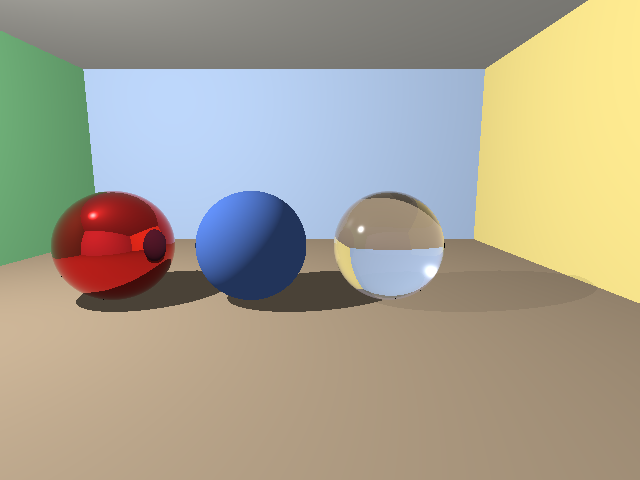

# Raytracer

教科書の最初に出てくるような、シンプルな Whitted 式レイトレーサです。
glTF バイナリ(`.glb`)のシーンを読み込み、640x480 のフレームバッファに描画して SDL2 のウィンドウに表示します。



## 機能

- GLB(glTF 2.0)ローダ(JSON パーサも自前実装。外部ライブラリは SDL2 のみ)
  - メッシュ、ノード変換(TRS / matrix / 子ノード)、PBR 材質(baseColor / metallic / roughness)、`KHR_materials_transmission`、カメラ
- BVH による高速化(約31万三角形のシーンを数秒で描画)
- レイトレーシング
  - 拡散反射 + Blinn-Phong、点光源、影(ガラスは薄い影)
  - 金属・低 roughness 材質の鏡面反射(フレネル)
  - ガラスの屈折(IOR 1.5、フレネル、全反射)
- マルチスレッドで走査線ごとに描画し、描画の進行をウィンドウに表示

## ビルドと実行

必要なもの: C++17 コンパイラ、CMake 3.24 以上、SDL2(macOS なら `brew install sdl2 cmake`)。
初回の `cmake` の設定時に、操作パネル用の Dear ImGui(MIT)を GitHub から取得します(固定バージョン + ハッシュ検証。[docs/THIRD_PARTY.md](docs/THIRD_PARTY.md))。

```sh
cmake -S . -B build
cmake --build build
./build/raytrace                    # 既定: Scene/Test/Untitled.glb
./build/raytrace Assets/VW_Beetle_1967.glb   # 別の GLB を指定(例: ビートル単体)
./build/raytrace path/to/scene.glb  # 別のシーン
```

リポジトリのルートで実行してください。ウィンドウの左に画像、右に操作パネルが出ます。


- サンプル数、ジッタ、シード、スレッド数、最大反射回数、シーンを変えて、**Render** ボタンで再描画します。**Cancel** で中断できます。
- 露出とガンマは、再描画なしで、その場で画像に反映されます。
- **Save** で、画像(PNG)・線形の浮動小数(PFM)・設定と時間(JSON)を保存します。
- Esc キーまたはウィンドウを閉じると終了します。

```sh
# ウィンドウなしで描画し、画像(PNG)・線形の浮動小数(PFM)・設定と時間(JSON)を保存
./build/raytrace Scene/Test/Room_2Spheres.glb --headless --repeat 5 --out experiments/test/run
# サンプル数・ジッタ(アンチエイリアス)・乱数のシード、画像の差(RMSE)
./build/raytrace Scene/Test/Room_2Spheres.glb --headless --jitter --spp 16 --seed 1 --out out
./build/raytrace --rmse out.pfm other.pfm
./build/raytrace_tests              # テスト
./build/raytrace --gui-selftest /tmp/gui   # 操作パネルの自動操作テスト(画面なしなら SDL_VIDEODRIVER=dummy を付ける)
```

## カメラとライトについて

- カメラ: GLB にカメラがあればそれを使います(横方向の視野を保ったまま 4:3 に描画)。なければ [src/main.cpp](src/main.cpp) の固定値を使います。
- ライト: GLB のライトはまだ読み込まず、点光源を固定位置に置いています。Blender のエリアライトは glTF に書き出されません。

## シーン・アセット

- `Scene/Test/Room_2Spheres.glb`: 基準シーン(部屋、金属球、ガラス球。球は部屋の中心に対称)
- `Scene/Test/Untitled.glb`: Blender で作成した検証用シーン(部屋、金属球、青い拡散球、ガラス球)
- `Assets/VW_Beetle_1967.glb`: Blender で手作りした1967年式フォルクスワーゲン・ビートル風のモデル(約31万三角形。簡易的な形状で、正確な再現ではありません)。
  レンダリングが重いため、現在のシーンには含めていません。

## 今後の予定

- GLB のライトの読み込み
- 距離減衰、アンチエイリアシング、クリアコートなど材質の拡張

## ドキュメント

- [docs/WORKFLOW.md](docs/WORKFLOW.md): 進め方のルール
- [docs/WORKLOG.md](docs/WORKLOG.md): 作業ログ
- [docs/CURRENT_IMPLEMENTATION.md](docs/CURRENT_IMPLEMENTATION.md): 現在の実装
- [docs/RENDERER_ROADMAP.md](docs/RENDERER_ROADMAP.md): ロードマップ
