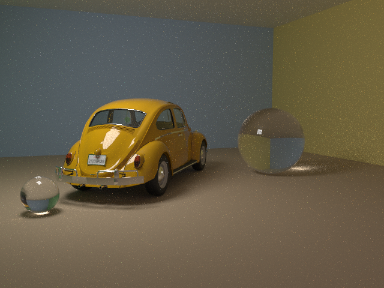

# Raytracer

教科書の最初に出てくるような Whitted 式レイトレーサから出発して、モンテカルロ法(面光源のサンプリング)、**パストレーシング(NEE、段階描画)**まで拡張した、学習用のレイトレーサです。
古典的手法から現代の技術まで、[ロードマップ](docs/RENDERER_ROADMAP.md)に沿って、1歩ずつ実装し、画像と数値で確かめています(現在: M0〜M5、M7 完了、M8 はテクスチャまで。次は M6(フォトンマッピング)か、M8 の続き(法線マップ・HDRI))。
Blender で作った glTF バイナリ(`.glb`)のシーンを読み込み、640x480 で描画して、操作パネル付きのウィンドウに表示します。



*このレンダラーの最新の描画。約47万三角形の空冷ビートル + ガラス球 2 個(パストレーシング、PBR、面光源の NEE + MIS、Russian Roulette、baseColor・metallicRoughness テクスチャ、256 spp、640x480、描画 52 s)。ビートルのモデルは CGTrader「VW Classic Bettle」(Royalty Free License)で、モデルのファイル自体はこのリポジトリに含めていません。条件・時間・Blender との比較は [experiments/2026-10-16_beetle/notes.md](experiments/2026-10-16_beetle/notes.md)。*

## 機能

- GLB(glTF 2.0)ローダ(JSON パーサ・PNG デコーダも自前実装。外部ライブラリは SDL2 のみ)
  - メッシュ、UV、ノード変換(TRS / matrix / 子ノード)、PBR 材質(baseColor / metallic / roughness)、**テクスチャ(baseColor、metallicRoughness。埋め込み PNG、`--no-textures` で無効化)**、`KHR_materials_transmission`、カメラ
- BVH による高速化(中央値分割 / SAH、近い子から先に走査、Path の影レイは any-hit。約30万三角形のシーンを、1フレーム十数 ms で描画。BVH なし(全三角形)との比較、スレッド数との関係も測定)
- レイトレーシング
  - 拡散反射 + Blinn-Phong、**面光源(矩形をランダムにサンプリング、ソフトシャドウ)**または点光源、影(ガラスは薄い影)
  - 金属・低 roughness 材質の鏡面反射(フレネル)
  - ガラスの屈折(IOR 1.5、フレネル、全反射)
- **PBR の材質**(`--integrator path`、既定): glTF の metallic / roughness / transmission / IOR に対応。GGX のマイクロファセット(見える法線のサンプリング)、Fresnel、多重散乱の補正、滑らかなガラス(屈折・全反射)、鏡。拡散と鏡面のエネルギー保存を、白い炉と数値積分で確認。同じシーンを Blender Cycles と比べて、鋭い金属・鏡は 0.3% 以内で一致(他は 2〜5% の差)。旧 Lambert モデルは `--bsdf lambert`。粗いガラスは未対応
- **パストレーシング**(`--integrator path`): コサイン重み付きサンプリング、反射回数の指定、NEE(光源への直接サンプリング、`--no-nee` で切り替え)、**MIS**(光源サンプリングと BSDF サンプリングの組み合わせ、既定。`--no-mis`)、**Russian Roulette**(`--rr`)。拡散面どうしの間接光(カラーブリーディング)が描ける。Cornell Box で NEE により、同じ spp の誤差が約 1/4
- **段階描画**(ウィンドウの既定): 1→4→16→64→… spp と更新し、後から「+ samples」で追加できる。パスの分け方によらず、同じ画像
- **画像のズーム・パン**(スクロール / ドラッグ / ダブルクリックで全体表示)、カーソル下のピクセル値の表示
- モンテカルロ法: 再現性のある乱数(PCG32、ピクセルごとに独立。スレッド数によらず結果が同一)、1ピクセルのサンプル数(`--spp`)、ピクセル内のランダムな位置(ジッタ = アンチエイリアス)
- 線形の浮動小数の film と、表示変換(露出・ガンマ)の分離。画像は PNG・PFM(線形)で保存、画像どうしの差(RMSE)を測れる
- マルチスレッドで走査線ごとに描画し、描画の進行をウィンドウに表示
- 操作パネル(Dear ImGui)、画面なしの描画、設定・時間・レイ数を記録する JSON、テスト(2100項目)、再現できる実験(`experiments/`)

## ビルドと実行

必要なもの: C++17 コンパイラ、CMake 3.24 以上、SDL2(macOS なら `brew install sdl2 cmake`)。
初回の `cmake` の設定時に、操作パネル用の Dear ImGui(MIT)を GitHub から取得します(固定バージョン + ハッシュ検証。[docs/THIRD_PARTY.md](docs/THIRD_PARTY.md))。

```sh
cmake -S . -B build-release -DCMAKE_BUILD_TYPE=Release   # 描画・時間の計測用(最適化あり。Debug の約11倍速い)
cmake --build build-release
./build-release/raytrace                    # 既定: Scene/Test/Untitled.glb
./build-release/raytrace Assets/VW_Beetle_1967.glb   # 別の GLB を指定(例: ビートル単体)
./build-release/raytrace path/to/scene.glb  # 別のシーン
```

デバッグ用には、`cmake -S . -B build -DCMAKE_BUILD_TYPE=Debug` の `build/` を使います(最適化なしで遅いので、描画や時間の計測には使わないでください)。

リポジトリのルートで実行してください。ウィンドウの左に画像、右に操作パネルが出ます。


- サンプル数、ジッタ、シード、スレッド数、最大反射回数、光源(点 / 面)と面光源の大きさ、シーンを変えて、**Render** ボタンで再描画します。**Cancel** で中断できます。
- 露出とガンマは、再描画なしで、その場で画像に反映されます。
- **Save** で、画像(PNG)・線形の浮動小数(PFM)・設定と時間(JSON)を保存します。
- Esc キーまたはウィンドウを閉じると終了します。

```sh
# ウィンドウなしで描画し、画像(PNG)・線形の浮動小数(PFM)・設定と時間(JSON)を保存
./build/raytrace Scene/Test/Room_2Spheres.glb --headless --repeat 5 --out experiments/test/run
# サンプル数・ジッタ(アンチエイリアス)・乱数のシード、画像の差(RMSE)
./build/raytrace Scene/Test/Room_2Spheres.glb --headless --jitter --spp 16 --seed 1 --out out
./build/raytrace Scene/Test/Room_2Spheres.glb --headless --light area --light-size 0.5 --spp 64 --out out   # 小さい面光源(影がくっきり)
./build/raytrace Scene/Test/Room_2Spheres.glb --headless --light point --legacy-normals --out out   # M0 の基準を再現(輪郭の扱いを旧方式に)
./build-release/raytrace Scene/Test/Beetle_Room.glb --headless --integrator path --spp 64 --cull-backfaces --out out   # 壁の裏側(部屋の外)から見ても、壁が消える(glTF の doubleSided = false を守る)
./build/raytrace --rmse out.pfm other.pfm
./build/raytrace_tests              # テスト
./build/raytrace --gui-selftest /tmp/gui   # 操作パネルの自動操作テスト(画面なしなら SDL_VIDEODRIVER=dummy を付ける)
```

## カメラとライトについて

- カメラ: GLB にカメラがあればそれを使います(横方向の視野を保ったまま 4:3 に描画)。なければ [src/main.cpp](src/main.cpp) の固定値を使います。
- ライト: Blender のエリアライトは glTF に書き出されないため、Blender のカスタムプロパティ(大きさ、明るさ)を GLB の extras に出して、レンダラが読みます。面光源(矩形)をランダムにサンプリングして、ソフトシャドウを描きます。点光源(M0 の基準方式)にも切り替えられます(`--light point`)。

## シーン・アセット

- `Scene/Test/TextureTest.glb`: テクスチャ読み込みの最小のテスト(市松模様の床 + metallicRoughness、128x128 の模様の壁。`tools/make_texture_test.py` で生成。すべてのフィルタ・動的 Huffman の PNG を含む)
- `Scene/Test/MaterialRow.glb`: 材質の球列(`tools/make_material_row.py` で生成。金・赤いプラスチック、roughness 0.05〜1.0、ガラス球 IOR 1.2 / 1.5 / 2.4、鏡)。PBR の確認用
- `Scene/Test/Cornell.glb`: Cornell Box(`tools/make_cornell.py` で生成。赤壁・緑壁・白い箱2個・天井の面光源)。パストレーシング(`--integrator path`)の検証用
- `Scene/Test/Room_2Spheres.glb`: 基準シーン(部屋、金属球、ガラス球。球は部屋の中心に対称)
- `Scene/Test/Untitled.glb`: Blender で作成した検証用シーン(部屋、金属球、青い拡散球、ガラス球)
- `Scene/Test/Beetle_Room.glb`(**Git 対象外**): 部屋 + 購入モデル(CGTrader の空冷ビートル、約47万三角形)+ ガラス球 2 個。Blender から `tools/export_beetle_room.py` で書き出す。このファイルは、ビートルを単色の材質に置き換えたもの(`--no-textures` と同じ見た目の近似)。テクスチャ付きは `Scene/Test/Beetle_Room_rear_tex.glb`(`tools/export_beetle_room_textured.py`。UDIM を 1 枚のアトラスにまとめて書き出す)。描画例: `docs/screenshots/2026-10-16_beetle-room-256spp-path-pbr.png`(256 spp、113 s、`experiments/2026-10-16_beetle/`)。修正済みの Blender ファイルは `Assets/bettle/Bettle_Blender.blend`(Git 対象外)。購入モデル(CGTrader「VW Classic Bettle」、Royalty Free License)の描画画像は公開できる見込み(ユーザーが確認)。モデルのファイル自体は再配布しない
- `Assets/VW_Beetle_1967.glb`: Blender で手作りした1967年式フォルクスワーゲン・ビートル風のモデル(約31万三角形。簡易的な形状で、正確な再現ではありません)。
  レンダリングが重いため、現在のシーンには含めていません。

## 今後の予定

[ロードマップ](docs/RENDERER_ROADMAP.md)のとおり。次は M6(フォトンマッピング。ガラス越しの光のコースティクスがちょうど題材)か M8(HDRI・テクスチャ・複雑なシーン)。
そのあと、NEE・MIS、フォトンマッピング、PBR、HDRI などへ進む予定です。

## ドキュメント

- [docs/WORKFLOW.md](docs/WORKFLOW.md): 進め方のルール
- [docs/WORKLOG.md](docs/WORKLOG.md): 作業ログ
- [docs/RENDERING_GUIDE.md](docs/RENDERING_GUIDE.md): レンダリングの考え方の解説(spp とノイズ、パストレーシング、BSDF、NEE など。図・用語集つき)
- [docs/CURRENT_IMPLEMENTATION.md](docs/CURRENT_IMPLEMENTATION.md): 現在の実装
- [docs/RENDERER_ROADMAP.md](docs/RENDERER_ROADMAP.md): ロードマップ
