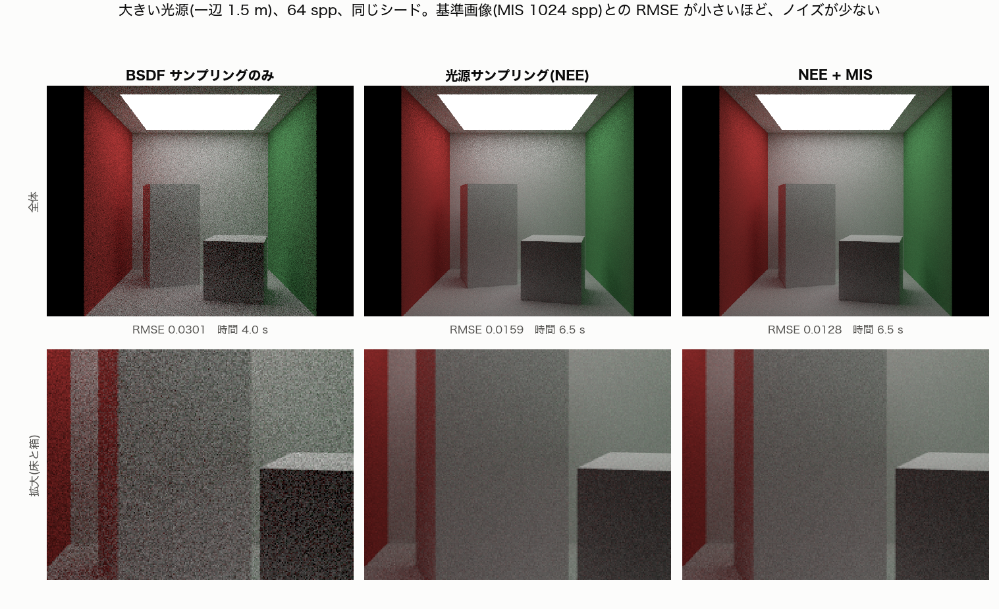
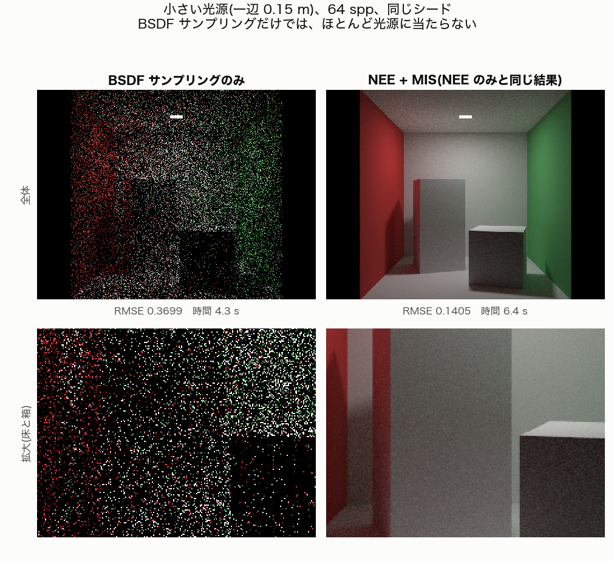
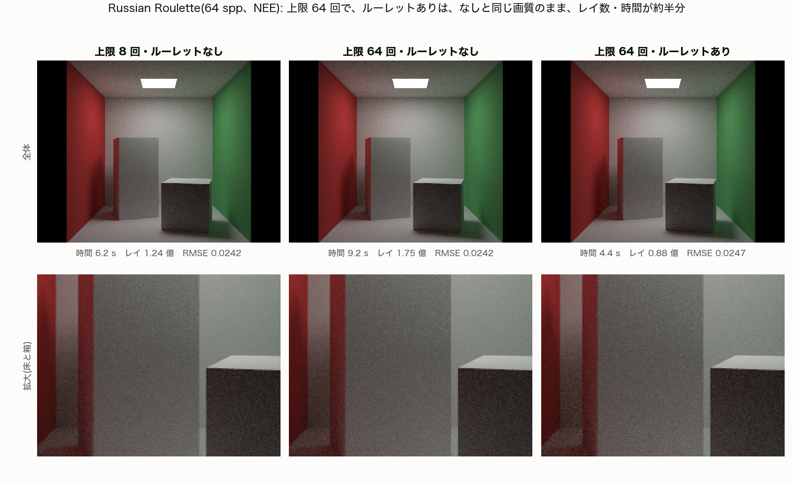

# レンダリングの解説(このレンダラーで使っている考え方)

**最終更新**: 2026-10-16

開発中に出た疑問を、「このレンダラーで、実際に何が起きているか」に結びつけて説明します。
実装の仕様は [CURRENT_IMPLEMENTATION.md](CURRENT_IMPLEMENTATION.md)、計画は [RENDERER_ROADMAP.md](RENDERER_ROADMAP.md)、
作業の記録は [WORKLOG.md](WORKLOG.md) にあります。ここは「なぜそうするのか」を、コードを読まなくても分かる程度に書く場所です。

数値は、実験で測ったもの(出典を書いたもの)だけを載せています。

## 目次

1. [1枚の画像が決まるまで](#1-1枚の画像が決まるまで)
2. [spp とノイズ](#2-spp-とノイズ)
3. [放射輝度と、面光源の明るさの式](#3-放射輝度と面光源の明るさの式)
4. [Whitted 式とパストレーシングの違い](#4-whitted-式とパストレーシングの違い)
5. [拡散面で方向がランダムになる理由](#5-拡散面で方向がランダムになる理由)
6. [BSDF と BSDF サンプリング](#6-bsdf-と-bsdf-サンプリング)
7. [NEE(次イベント推定)](#7-nee次イベント推定)
8. [プログレッシブ描画](#8-プログレッシブ描画)
9. [ビルドの種類(Debug と Release)](#9-ビルドの種類debug-と-release)
10. [MIS・Russian Roulette・delta 成分(M4)](#10-misrussian-rouletteデルタ成分m4)
11. [用語集](#11-用語集)

---

## 1. 1枚の画像が決まるまで

1. 画面の各ピクセルについて、カメラから、そのピクセルを通る**レイ(光線)**を飛ばす。
2. レイが最初に当たる点を探す(BVH で高速化)。
3. その点の明るさを、**1つの値**(放射輝度、下の3章)として求める。
4. 1ピクセルについて、これを N 回(N = spp)繰り返して**平均**する。
5. 平均した値(線形)を film に蓄積し、最後に露出・ガンマをかけて表示する。

計算(線形の値)と表示(露出・ガンマ・8bit)は分けてあります。同じ film を、再描画なしで見え方だけ変えられます。

## 2. spp とノイズ

**spp** は samples per pixel(1ピクセルあたりのサンプル数)です。1ピクセルの色を求めるために、そのピクセルを通る経路を何本追跡して平均するか、という数です。

- 1 spp: 経路が1本だけ。ランダムな選び方に結果が左右され、ざらざらしたノイズになる。
- 64 spp: 64本の平均。ランダムな揺らぎが平均化され、ノイズが減る。

ノイズ(誤差)は、サンプル数が **4倍で約半分**(1/√N)になります。実験で確かめています:

| spp | 1 | 4 | 16 | 64 |
|---|---|---|---|---|
| 256 spp との RMSE(パストレーシング、NEE なし、8回反射) | 0.82 | 0.41 | 0.20 | 0.089 |

(出典: `experiments/2026-10-15_m2-cornell/`。基準の 256 spp 自体にもノイズが残っています。)

描画時間は spp にほぼ比例します。きれいにする方法は、サンプルを増やす(確実だが遅い)、または**同じ spp でノイズを減らす**工夫(NEE、MIS など)です。

## 3. 放射輝度と、面光源の明るさの式

**放射輝度(radiance)**は、ある点から、ある方向へ出ていく光の**明るさ**(単位面積・単位立体角あたりのパワー)です。
**レイ1本が運ぶ値**が放射輝度で、ピクセルの値は、その平均です。

- 見る距離によって変わらない(光源を遠くから見ても、表面の明るさは同じ。小さく見えるだけ)。
- 何も遮らなければ、レイに沿って値は変わらない。

| 似た言葉 | 意味 |
|---|---|
| 放射輝度 | ある点から、ある方向へ出る光の明るさ(レイが運ぶ値) |
| 放射照度 | ある面が、全方向から受け取る光の量 |
| パワー | 光源が出す光の総量(ワット) |

面光源の1点が、ある面の点に与える明るさの式(M1 で実装):

```text
放射輝度 × 面積 × cos(光源側の角度) × cos(受ける面側の角度) ÷ 距離²
```

| 条件 | 式の項 |
|---|---|
| 広い面積 | 面積が大きい |
| 強い光 | 放射輝度が大きい |
| 真正面から | cos が大きい(光源側・受ける側の両方) |
| 近く | 距離²が小さい(2乗で効く。距離が半分なら4倍) |

「面積」は、光源の上の点を一様に選ぶ確率(PDF = 1/面積)で割った結果です。
`--light-size` で光源の大きさを変えても、**放射輝度 × 面積(総電力)が一定**になるようにしてあるので、全体の明るさは変わらず、影のやわらかさだけが変わります。

## 4. Whitted 式とパストレーシングの違い

| | Whitted 式(Classic、M0〜M1) | パストレーシング(Path、M2〜) |
|---|---|---|
| 拡散面に当たったら | 光源の上の1点へシャドウレイを飛ばし、遮られていなければ明るさを足して**終わり** | ランダムな方向へ反射して**先へ進む**(反射回数の上限まで) |
| 反射・屈折の再帰 | **鏡とガラスだけ** | 拡散面でも続く |
| 拡散面どうしの反射光(間接光、カラーブリーディング) | ない(環境光の定数 0.12 で代用) | 自然に出る |
| 光源の扱い | 位置を知っていて、直接確認する | 偶然当たるのを待つ(NEE なしの場合) |
| ノイズ | 少ない | 多い(NEE で減らせる) |

パストレーシングの経路は、次のどれかで終わります。

- 光源に当たる(光を拾って終了)
- 何にも当たらずに外へ出る(環境光 0 なら真っ黒)
- 反射回数の上限に達する(`--max-depth`)

たとえば「カメラ → 白い床 → 赤い壁 → 白い天井 → 光源」という経路では、光が赤い壁の色を帯びて床に届きます。これがカラーブリーディングで、Whitted 式は床で終わるので辿れません。
Cornell Box で、反射回数を 0 → 1 → 2 → … と増やすと、天井が暗い状態から明るくなり、背の高い箱の側面が赤く、低い箱が緑がかっていくのが見えます(`docs/screenshots/2026-10-15_cornell-path-no-nee-bounce*.png`)。

## 5. 拡散面で方向がランダムになる理由

紙や壁のような面に光が当たると、表面の細かい**凹凸**で光があちこちに散乱します。
ランバート面(完全拡散)では、出ていく光の明るさが、見る方向によらず同じに見えます。

レンダラーでは、光の「束」が分かれるのを計算する代わりに、**1本の経路について、方向をランダムに1つ選ぶ**ことで近似します(モンテカルロ法)。たくさんの経路を平均すると、全方向への散乱の平均になります。

「弱まる」の中身は2つあります。

1. **アルベド(反射率)**: 面が光を吸収する分、反射のたびに弱まる。スループットに色として掛ける(赤い壁なら赤以外が吸収される)。
2. **方向による割合**: 法線に近い方向ほど多く出る(コサイン則)。方向の選び方も、法線に近い方向が出やすい**コサイン重み付き半球サンプリング**にしてある。

この2つを組み合わせると、`BSDF × cos ÷ PDF` が、ちょうど**アルベドだけ**になります。

## 6. BSDF と BSDF サンプリング

**BSDF**(Bidirectional Scattering Distribution Function)は、「ある方向から来た光が、別のある方向へ、どれだけ出ていくか」を表す関数で、**材質の性質そのもの**です。

**BSDF サンプリング**は、その性質に合わせて、反射の方向を確率的に選ぶ方法です。出ていきやすい方向ほど、よく選びます。


(面を真横から見た断面。線の長さ = 選ばれやすさ。3つは形が比べやすいように最大の長さをそろえてある。ピークの確率密度は、図の下の数値で比べる。3次元では、この形を法線または反射方向のまわりに回転させたもの。図は `tools/plot_bsdf_sampling.py` で描いた。)

- **拡散面**(左): 法線方向がいちばん選ばれやすく、すれすれの方向はほとんど選ばれない(`確率 ∝ cos θ`)。入射方向によらず同じ形。**いまの Path 方式は、これだけ**。
- **鏡**(中): 反射方向の1本だけ(確率 100%、確率密度は無限大。delta 分布)。
- **つやのある面**(右): 鏡面反射の方向のまわりに集中。鋭さ(n)が大きいほど細い(図は n = 40 の例)。**M7 で追加予定**。

光が出ていきにくい方向を選んでも、寄与が小さく、計算が無駄になります。出ていきやすい方向を選ぶことで、同じサンプル数でノイズが減ります。

そのとき、**選ぶ確率(PDF)で寄与を割る**ことで、どの選び方でも、期待値(収束先の絵)が同じになります。これがモンテカルロ法で選び方を自由に変えられる理由です。

**光源サンプリングとの違い**: どちらも「次にどの方向を見るか」を選ぶ方法ですが、基準が違います。

| | BSDF サンプリング | 光源サンプリング(NEE) |
|---|---|---|
| 選び方の基準 | 面の性質(出ていきやすい方向) | 光源の位置(光源の上の点) |
| 得意な場面 | つやのある面、大きい光源 | 小さい光源 |
| 苦手な場面 | 小さい光源(当たりにくい) | つやの強い面 |

## 7. NEE(次イベント推定)

**NEE**(Next Event Estimation)は、パストレーシングで、**反射点に着くたびに、光源の上の点へ直接シャドウレイを飛ばして、その点の直接照明を確実に計算する**方法です。

```text
各反射点で、2つを足す:
 (1) 光源の寄与 … 光源の一様ランダムな点を選び、遮られていなければ計算する(Whitted 式と同じ計算)
 (2) 他の面からの寄与 … コサイン重み付きでランダムな方向に反射して、先へ進む(NEE なしと同じ)
```

- 直接光は、運に頼らず毎回確実に拾える。間接光は、これまでどおりランダムな反射の先で拾う。
- **二重計上を避ける**: (2) の経路が偶然光源に当たっても、その分は**足さない**(光源の寄与は (1) で計算済みなので、足すと2倍になる)。ただし、カメラレイが光源を直接見る場合は足す。

### NEE は「物理的な嘘」ではない

NEE は、**結果の期待値(収束先の絵)を変えずに、ノイズだけを減らす**方法です。
反射点に届く直接光は「光源の各点から来る光の合計」で、これを次の2通りで見積もれます。

- ランダムな方向に飛ばして、光源に当たった分を数える(NEE なし)。
- 光源の上の点をランダムに選んで、その寄与を計算する(NEE)。

どちらも同じ積分の推定で、サンプルを増やせば同じ答えに収束します。違いは、収束の速さだけです。
嘘にならない条件は、**選ぶ確率(PDF)で寄与を正しく割ること**と、**二重計上しないこと**です。

物理的に嘘(近似)になるのは、別のものです。Whitted 式の環境光の定数、Phong のスペキュラ(エネルギー保存の裏付けなし)、ガラスの簡易な影などです。

### 実験結果

Cornell Box、8回反射、基準画像 = NEE 1024 spp との RMSE(出典: `experiments/2026-10-15_m4-nee/`):

| spp | NEE あり | NEE なし |
|---|---|---|
| 1 | 0.179 | 0.819 |
| 4 | 0.093 | 0.410 |
| 16 | 0.047 | 0.205 |
| 64 | 0.025 | 0.103 |
| 256 | 0.013 | 0.052 |

- 同じ spp で、誤差は約 **1/4**(同じ誤差に必要なサンプルは約 1/16)。
- NEE は1サンプルあたり約 **1.5倍遅い**(Release で 256 spp: 約 26 秒 / 17 秒)。
- 同じ画質なら、**約 10倍速い**(NEE の 16 spp ≒ NEE なしの 256 spp)。
- NEE あり/なしの期待値が一致することは、テストで確認している(反射回数 1・2・3)。

画像: `docs/screenshots/2026-10-15_cornell-path-nee-8bounce-*.png`(NEE あり)、`...-no-nee-8bounce-*.png`(NEE なし)。

## 8. プログレッシブ描画

1ピクセルの総サンプル数を **1 → 4 → 16 → 64 → …(4倍ずつ)** と増やし、各パスの終わりに画像を更新します。最後のパスは、目標の spp にちょうど届きます。

- ノイズの減る様子を見られる。初めの数秒で、全体の構図と色が分かる。
- 完了後に「**+ samples**」で、何もリセットせずにサンプルを足せる。
- パネルの設定(反射回数、光源、積分方式、NEE など)を変えると、蓄積を捨てて描き直す。
- **再現性**: サンプル番号は、パスをまたいで通し番号(0, 1, 2, …)。1ピクセルのサンプルは、いつも同じ順で足されるので、パスの分け方によらず、**フィルムはビット単位で同一**。段階描画と一括描画の PNG は、実際にバイト単位で同一だった(`experiments/2026-10-15_m3-progressive/`)。

## 9. ビルドの種類(Debug と Release)

- **Debug**(`build/`): 最適化なし。デバッグ用。
- **Release**(`build-release/`、`-O3 -DNDEBUG`): 描画・計測・テスト用。

同じ描画(Cornell Box、16 spp)で、Debug が 34.3 秒、Release が 3.1 秒(**約 11倍**)で、画像は同一でした。
時間を測るときは、必ず Release を使ってください。画像と RMSE は、ビルドの種類に依存しません。
(M2〜M3 の実験の描画時間は Debug の値。Release で測り直す必要があります。)

## 10. MIS・Russian Roulette・delta 成分(M4)

### PDF を立体角で揃える

2つの方法の「ある方向を選ぶ確率」を、同じ単位(立体角あたり)で計算できるようにしました。MIS の重みを作るための下準備です。

- BSDF サンプリング(コサイン重み付き): `pdf = cos θ / π`
- 光源サンプリング(光源の上の点を一様に選ぶ): 面積あたりの密度 `1 / 面積` を、立体角あたりに直すと `pdf = 距離² ÷ (面積 × cos(光源側))`

どちらも、「選べる方向の全体で積分すると 1 になる」ことをテストで確認しています。

### MIS(Multiple Importance Sampling)

光源サンプリング(NEE)と BSDF サンプリングは、得意・不得意が逆です。

- 小さい光源 → NEE が得意。BSDF サンプリングは、光源に当たりにくい。
- 大きい光源(や、つやのある面) → BSDF サンプリングも当たりやすい。

そこで、**両方で光を拾い、同じ方向を選ぶ確率が高いほうを重く扱う**重みを掛けて足します(Power Heuristic: 重み = `自分の PDF² ÷ (自分の PDF² + 相手の PDF²)`)。同じ方向を2つの方法で作れる場合の重みの合計は常に 1 なので、二重計上になりません。いままでの「BSDF サンプリングが光源に当たっても足さない」は、重みを 0 と 1 にした極端な場合です。

実験結果(Cornell Box、8回反射、64 spp、光源は総電力一定。基準画像 = MIS 1024 spp との RMSE。`experiments/2026-10-15_m4-mis/`):

| 光源の一辺 | BSDF のみ | NEE | NEE + MIS |
|---|---|---|---|
| 0.15 m | 0.370 | 0.1405 | 0.1405 |
| 0.5 m | 0.103 | 0.0246 | 0.0246 |
| 1.5 m | 0.0301 | 0.0159 | **0.0128** |

**大きい光源(一辺 1.5 m)** — 3つの画像は、同じシード・同じ 64 spp です。下段は、床と箱のあたりの拡大です。



- 左の BSDF サンプリングのみは、大きい光源なので光源に当たりやすく、画像としては成り立っています。ただし、粒(ノイズ)が最も目立ちます。
- 中の NEE は、粒がかなり減ります。右の MIS は、さらに少しなめらかになります(RMSE 0.0159 → 0.0128、約 20% 減)。
- 時間は、NEE と MIS で同じ(6.5 秒)です。MIS の重みの計算は、ほとんど負担になりません。

**小さい光源(一辺 0.15 m)** — NEE と MIS は同じ結果になるので、MIS だけを載せます。



- BSDF サンプリングのみは、小さい光源に偶然当たる経路がほとんどなく、画像がほぼ点(ノイズ)になります(RMSE 0.370)。
- MIS(= NEE)は、同じ spp で、はるかにきれいです(RMSE 0.1405)。小さい光源では、BSDF 側の重みがほぼ 0 になり、光源サンプリングだけを使っているのと同じです。

まとめると:

- 小さい光源では、MIS は NEE と同じ(BSDF 側の重みがほぼ 0 になる)。BSDF のみは、桁違いに悪い。
- 大きい光源では、MIS が NEE より約 20% 低ノイズ(同じ時間あたりの効率で約 1.5 倍)。
- 3方式が同じ期待値であることは、テストで確認した。MIS の重みをわざと誤らせると、テストが失敗する。
- MIS を**既定にした**(悪くなる場面がなく、大きい光源で良くなるため)。`--no-mis` で NEE のみにできる。基準画像が MIS なので、MIS にわずかに有利な可能性がある。

つやのある面では、さらに効果が大きいはずですが、材質がまだ拡散(Lambert)のみなので、未確認です(M7)。

### Russian Roulette

反射回数の上限で打ち切ると、上限を超えた分の光が落ちて、わずかに暗くなります(バイアス)。代わりに、各反射のあとで確率 p で経路を続け、確率 1−p で打ち切り、続ける経路の寄与を 1/p 倍します。期待値は変わらず、暗くなった経路が早く打ち切られるので、平均すると速くなります。

このレンダラーでは、3回反射から、p = スループットの最大成分(0.05〜0.95 に制限)です(`--rr`)。`--max-depth` は上限として残ります。

実験結果(Cornell Box、NEE、64 spp、上限 64 回。`experiments/2026-10-15_m4-russian-roulette/`):

| 方式 | 時間 | レイ数 | 平均輝度(基準との比、R) |
|---|---|---|---|
| 上限 8 回、ルーレットなし | 6.2 s | 1.24 億 | 0.9971(約 0.3% 暗い) |
| 上限 64 回、ルーレットなし | 9.2 s | 1.75 億 | 1.0002 |
| 上限 64 回、ルーレットあり | 4.4 s | 0.88 億 | 1.0002 |



(下段は、床と箱のあたりの拡大です。)

- 右(ルーレットあり)は、中(ルーレットなし、同じ上限 64 回)と、見た目も RMSE もほぼ同じです(0.0247 と 0.0242)。平均輝度も一致します(バイアスなし)。
- それでいて、レイ数は半分、時間は約 1/2.1 です。
- 拡大を見ると、ルーレットありは、暗い所(赤い壁の下の床)に、少し粒が残ります。暗い経路を確率的に捨てるので、生き残った経路の重みが大きくなるためです。平均の明るさは変わりませんが、粒は、わずかに増えます。
- 左(上限 8 回)は、上限を超えた分の光が落ちて、わずかに暗くなります(約 0.3%)。見た目では、ほとんど分かりません。
- 1/p の補正を外すと、テストが失敗する(明るさがずれる)。
- 反射回数ごとの比較(0/1/2/4/8)をしたいときは、ルーレットなしにする。既定はオフ。

### delta 成分(鏡・ガラス)

反射方向が1つに決まるので、光源サンプリングでは選べません(確率 0)。この面では MIS を使わず、BSDF サンプリングの寄与を 100% 足す、という分岐が必要です。**まだ実装していません**。Path 方式が Lambert のみで、delta の材質がないためです。鏡・ガラスを Path に入れるとき(または M7)に実装します。

## 11. 用語集

| 用語 | 意味 |
|---|---|
| レイ | 原点と方向を持つ光線。レイ1本が放射輝度の値を運ぶ |
| spp | samples per pixel。1ピクセルで平均する経路の数 |
| 放射輝度 | ある点から、ある方向へ出る光の明るさ |
| 放射照度 | ある面が全方向から受ける光の量 |
| 拡散(ランバート) | 表面の凹凸で光が散らばり、見る方向によらず同じ明るさに見える面 |
| アルベド | 面の反射率(吸収されずに反射される割合)。色で表す |
| BSDF | ある方向から来た光が、別の方向へどれだけ出るかを表す関数。材質の性質 |
| PDF | 確率密度関数。ある方向(や点)を選ぶ確率の密度。寄与を割って補正する |
| モンテカルロ法 | ランダムなサンプルの平均で、積分(明るさ)を見積もる方法 |
| 期待値 | サンプルを無限に増やしたときの平均(収束先の絵) |
| バイアス | 期待値が、正しい答えとずれていること(例: 反射回数の上限で暗くなる) |
| 分散・ノイズ | サンプルのばらつき。誤差は 1/√N で減る |
| NEE | 反射点から光源へ直接シャドウレイを飛ばす、直接照明の見積もり方 |
| MIS | 複数のサンプリング方法を、重み(Power Heuristic など)を付けて組み合わせる方法。このレンダラーでは、光源サンプリングと BSDF サンプリングを組み合わせる(既定) |
| Russian Roulette | 確率で経路を打ち切り、続ける分を 1/p 倍して補正する方法(バイアスなし) |
| delta 分布 | 方向が1つに決まる反射(完全な鏡など)。PDF が1点に集中する |
| 二重計上 | 同じ光を2回数えること。絵が明るすぎるバグになる |
| カラーブリーディング | 色のついた面からの反射光が、周りの面に色を移す現象 |
| プログレッシブ描画 | サンプルを段階的に足しながら、途中の画像を表示する描き方 |
| film | 線形の放射輝度の合計とサンプル数を保持するバッファ |
| RMSE | 2つの画像の差の大きさ(二乗平均平方根)。基準画像との誤差の指標 |
