# レンダリングの解説(このレンダラーで使っている考え方)

**最終更新**: 2026-10-17

開発中に出た疑問を、「このレンダラーで、実際に何が起きているか」に結びつけて説明します。
実装の仕様は [CURRENT_IMPLEMENTATION.md](CURRENT_IMPLEMENTATION.md)、計画は [RENDERER_ROADMAP.md](RENDERER_ROADMAP.md)、
作業の記録は [WORKLOG.md](WORKLOG.md) にあります。ここは「なぜそうするのか」を、コードを読まなくても分かる程度に書く場所です。

数値は、実験で測ったもの(出典を書いたもの)だけを載せています。

## 目次

1. [1枚の画像が決まるまで](#1-1枚の画像が決まるまで)
2. [spp とノイズ](#2-spp-とノイズ)
3. [放射輝度と、面光源の明るさの式](#3-放射輝度と面光源の明るさの式)
4. [Whitted 式とパストレーシングの違い](#4-whitted-式とパストレーシングの違い)
5. [拡散面で方向がランダムになる理由](#5-拡散面で方向がランダムになる理由)
6. [BSDF と BSDF サンプリング](#6-bsdf-と-bsdf-サンプリング)
7. [NEE(次イベント推定)](#7-nee次イベント推定)
8. [プログレッシブ描画](#8-プログレッシブ描画)
9. [ビルドの種類(Debug と Release)](#9-ビルドの種類debug-と-release)
10. [MIS・Russian Roulette・delta 成分(M4)](#10-misrussian-rouletteデルタ成分m4)
11. [BVH と並列化(M5)](#11-bvh-と並列化m5)
12. [PBR の材質: Fresnel・GGX・ガラス(M7)](#12-pbr-の材質-fresnelggxガラスm7)
13. [層のある材質: クリアコートと表面下散乱(考え方。未実装)](#13-層のある材質-クリアコートと表面下散乱考え方未実装)
14. [用語集](#14-用語集)

---

## 1. 1枚の画像が決まるまで

1. 画面の各ピクセルについて、カメラから、そのピクセルを通る**レイ(光線)**を飛ばす。
2. レイが最初に当たる点を探す(BVH で高速化)。
3. その点の明るさを、**1つの値**(放射輝度、下の3章)として求める。
4. 1ピクセルについて、これを N 回(N = spp)繰り返して**平均**する。
5. 平均した値(線形)を film に蓄積し、最後に露出・ガンマをかけて表示する。

計算(線形の値)と表示(露出・ガンマ・8bit)は分けてあります。同じ film を、再描画なしで見え方だけ変えられます。

## 2. spp とノイズ

**spp** は samples per pixel(1ピクセルあたりのサンプル数)です。1ピクセルの色を求めるために、そのピクセルを通る経路を何本追跡して平均するか、という数です。

- 1 spp: 経路が1本だけ。ランダムな選び方に結果が左右され、ざらざらしたノイズになる。
- 64 spp: 64本の平均。ランダムな揺らぎが平均化され、ノイズが減る。

ノイズ(誤差)は、サンプル数が **4倍で約半分**(1/√N)になります。実験で確かめています:

| spp | 1 | 4 | 16 | 64 |
|---|---|---|---|---|
| 256 spp との RMSE(パストレーシング、NEE なし、8回反射) | 0.82 | 0.41 | 0.20 | 0.089 |

(出典: `experiments/2026-10-15_m2-cornell/`。基準の 256 spp 自体にもノイズが残っています。)

描画時間は spp にほぼ比例します。きれいにする方法は、サンプルを増やす(確実だが遅い)、または**同じ spp でノイズを減らす**工夫(NEE、MIS など)です。

## 3. 放射輝度と、面光源の明るさの式

**放射輝度(radiance)**は、ある点から、ある方向へ出ていく光の**明るさ**(単位面積・単位立体角あたりのパワー)です。
**レイ1本が運ぶ値**が放射輝度で、ピクセルの値は、その平均です。

- 見る距離によって変わらない(光源を遠くから見ても、表面の明るさは同じ。小さく見えるだけ)。
- 何も遮らなければ、レイに沿って値は変わらない。

| 似た言葉 | 意味 |
|---|---|
| 放射輝度 | ある点から、ある方向へ出る光の明るさ(レイが運ぶ値) |
| 放射照度 | ある面が、全方向から受け取る光の量 |
| パワー | 光源が出す光の総量(ワット) |

面光源の1点が、ある面の点に与える明るさの式(M1 で実装):

```text
放射輝度 × 面積 × cos(光源側の角度) × cos(受ける面側の角度) ÷ 距離²
```

| 条件 | 式の項 |
|---|---|
| 広い面積 | 面積が大きい |
| 強い光 | 放射輝度が大きい |
| 真正面から | cos が大きい(光源側・受ける側の両方) |
| 近く | 距離²が小さい(2乗で効く。距離が半分なら4倍) |

「面積」は、光源の上の点を一様に選ぶ確率(PDF = 1/面積)で割った結果です。
`--light-size` で光源の大きさを変えても、**放射輝度 × 面積(総電力)が一定**になるようにしてあるので、全体の明るさは変わらず、影のやわらかさだけが変わります。

## 4. Whitted 式とパストレーシングの違い

| | Whitted 式(Classic、M0〜M1) | パストレーシング(Path、M2〜) |
|---|---|---|
| 拡散面に当たったら | 光源の上の1点へシャドウレイを飛ばし、遮られていなければ明るさを足して**終わり** | ランダムな方向へ反射して**先へ進む**(反射回数の上限まで) |
| 反射・屈折の再帰 | **鏡とガラスだけ** | 拡散面でも続く |
| 拡散面どうしの反射光(間接光、カラーブリーディング) | ない(環境光の定数 0.12 で代用) | 自然に出る |
| 光源の扱い | 位置を知っていて、直接確認する | 偶然当たるのを待つ(NEE なしの場合) |
| ノイズ | 少ない | 多い(NEE で減らせる) |

パストレーシングの経路は、次のどれかで終わります。

- 光源に当たる(光を拾って終了)
- 何にも当たらずに外へ出る(環境光 0 なら真っ黒)
- 反射回数の上限に達する(`--max-depth`)

たとえば「カメラ → 白い床 → 赤い壁 → 白い天井 → 光源」という経路では、光が赤い壁の色を帯びて床に届きます。これがカラーブリーディングで、Whitted 式は床で終わるので辿れません。
Cornell Box で、反射回数を 0 → 1 → 2 → … と増やすと、天井が暗い状態から明るくなり、背の高い箱の側面が赤く、低い箱が緑がかっていくのが見えます(`docs/screenshots/2026-10-15_cornell-path-no-nee-bounce*.png`)。

## 5. 拡散面で方向がランダムになる理由

紙や壁のような面に光が当たると、表面の細かい**凹凸**で光があちこちに散乱します。
ランバート面(完全拡散)では、出ていく光の明るさが、見る方向によらず同じに見えます。

レンダラーでは、光の「束」が分かれるのを計算する代わりに、**1本の経路について、方向をランダムに1つ選ぶ**ことで近似します(モンテカルロ法)。たくさんの経路を平均すると、全方向への散乱の平均になります。

「弱まる」の中身は2つあります。

1. **アルベド(反射率)**: 面が光を吸収する分、反射のたびに弱まる。スループットに色として掛ける(赤い壁なら赤以外が吸収される)。
2. **方向による割合**: 法線に近い方向ほど多く出る(コサイン則)。方向の選び方も、法線に近い方向が出やすい**コサイン重み付き半球サンプリング**にしてある。

この2つを組み合わせると、`BSDF × cos ÷ PDF` が、ちょうど**アルベドだけ**になります。

## 6. BSDF と BSDF サンプリング

**BSDF**(Bidirectional Scattering Distribution Function)は、「ある方向から来た光が、別のある方向へ、どれだけ出ていくか」を表す関数で、**材質の性質そのもの**です。

**BSDF サンプリング**は、その性質に合わせて、反射の方向を確率的に選ぶ方法です。出ていきやすい方向ほど、よく選びます。


(面を真横から見た断面。線の長さ = 選ばれやすさ。3つは形が比べやすいように最大の長さをそろえてある。ピークの確率密度は、図の下の数値で比べる。3次元では、この形を法線または反射方向のまわりに回転させたもの。図は `tools/plot_bsdf_sampling.py` で描いた。)

- **拡散面**(左): 法線方向がいちばん選ばれやすく、すれすれの方向はほとんど選ばれない(`確率 ∝ cos θ`)。入射方向によらず同じ形。(M2 の Lambert モデルは、これだけ。PBR(第12章)は、これに次の2つを加える。)
- **鏡**(中): 反射方向の1本だけ(確率 100%、確率密度は無限大。delta 分布)。
- **つやのある面**(右): 鏡面反射の方向のまわりに集中。鋭さ(n)が大きいほど細い(図は n = 40 の例)。**M7 の PBR で実装**(第12章。鋭さは、実際には GGX の roughness で決まる)。

光が出ていきにくい方向を選んでも、寄与が小さく、計算が無駄になります。出ていきやすい方向を選ぶことで、同じサンプル数でノイズが減ります。

そのとき、**選ぶ確率(PDF)で寄与を割る**ことで、どの選び方でも、期待値(収束先の絵)が同じになります。これがモンテカルロ法で選び方を自由に変えられる理由です。

**光源サンプリングとの違い**: どちらも「次にどの方向を見るか」を選ぶ方法ですが、基準が違います。

| | BSDF サンプリング | 光源サンプリング(NEE) |
|---|---|---|
| 選び方の基準 | 面の性質(出ていきやすい方向) | 光源の位置(光源の上の点) |
| 得意な場面 | つやのある面、大きい光源 | 小さい光源 |
| 苦手な場面 | 小さい光源(当たりにくい) | つやの強い面 |

## 7. NEE(次イベント推定)

**NEE**(Next Event Estimation)は、パストレーシングで、**反射点に着くたびに、光源の上の点へ直接シャドウレイを飛ばして、その点の直接照明を確実に計算する**方法です。

```text
各反射点で、2つを足す:
 (1) 光源の寄与 … 光源の一様ランダムな点を選び、遮られていなければ計算する(Whitted 式と同じ計算)
 (2) 他の面からの寄与 … コサイン重み付きでランダムな方向に反射して、先へ進む(NEE なしと同じ)
```

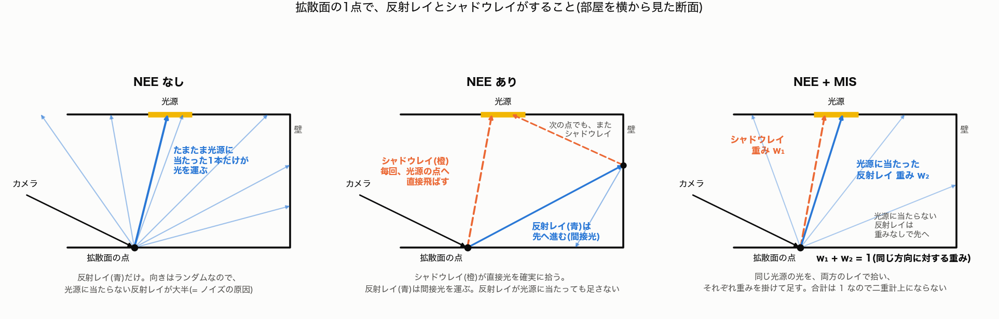

(部屋を横から見た断面。青 = 反射レイ、橙の点線 = シャドウレイ。左: NEE なし、中: NEE あり、右: NEE + MIS(第10章)。図は `tools/plot_ray_types.py` で描いた。)

- **反射レイ**(青): 面の性質に従って、ランダムな方向へ飛ぶ(BSDF サンプリング)。光源に当たるのは偶然。光源以外の面に当たれば、色を引き継いで次の点へ進む(間接光を運ぶ)。
- **シャドウレイ**(橙): 光源の上の点へ、直接飛ばす(光源サンプリング = NEE そのもの)。遮られていなければ、直接光を拾う。
- 直接光は、運に頼らず毎回確実に拾える。間接光は、これまでどおりランダムな反射の先で拾う。

シャドウレイは Whitted 式のころからありますが、反射レイを**拡散面でも**使うのは、パストレーシングからです(Whitted 式では、鏡とガラスだけ)。

### 光源に向かわない反射レイは、どうなるのか

1つの反射点で、2種類のレイを使います。

```text
反射点 X
 ├─ (A) シャドウレイ …… 光源の上の点へ直接飛ばす(NEE)
 │        遮られていなければ、直接光を足す
 │
 └─ (B) 反射レイ …… 面の性質に従って、ランダムな方向へ飛ばす(BSDF サンプリング)
          ├─ 光源に当たった → 直接光の候補として足す(NEE のみなら足さない、MIS なら重みつき)。経路は、ここで終わり
          └─ 光源以外の面に当たった → 次の反射点で、また (A) と (B) を繰り返す
```

光源に向かわない (B) のレイは、色(アルベド)をスループットに掛けて、次の点へ進みます。次の点に届く光源の光は、その点の (A) で拾い、他の面からの光は、その点の (B) で、さらに先へ進みます。この繰り返しで、間接光を拾います。赤い壁に当たった (B) が、赤い色を引き継いで光を拾うので、色移りが出ます。

つまり、1つの (B) のレイには、2つの役目があります。

| 役目 | いつ | 重み |
|---|---|---|
| 直接光の候補 | たまたま光源に当たったとき | MIS の重み(NEE と分け合う。第10章) |
| 間接光の運び役 | 光源以外の面に当たったとき | 重みなし(スループットを引き継ぐだけ) |

MIS が決めるのは、「光源に向かう方向の直接光を、(A) と (B) でどう分け合うか」だけです。光源に向かわない (B) の、間接光を運ぶ仕事は、MIS と関係なく、続きます。NEE や MIS は、直接光の数え方だけを改良したもので、間接光の数え方は変わりません。
- **二重計上を避ける**: (2) の経路が偶然光源に当たっても、その分は**足さない**(光源の寄与は (1) で計算済みなので、足すと2倍になる)。ただし、カメラレイが光源を直接見る場合は足す。

### NEE は「物理的な嘘」ではない

NEE は、**結果の期待値(収束先の絵)を変えずに、ノイズだけを減らす**方法です。
反射点に届く直接光は「光源の各点から来る光の合計」で、これを次の2通りで見積もれます。

- ランダムな方向に飛ばして、光源に当たった分を数える(NEE なし)。
- 光源の上の点をランダムに選んで、その寄与を計算する(NEE)。

どちらも同じ積分の推定で、サンプルを増やせば同じ答えに収束します。違いは、収束の速さだけです。
嘘にならない条件は、**選ぶ確率(PDF)で寄与を正しく割ること**と、**二重計上しないこと**です。

物理的に嘘(近似)になるのは、別のものです。Whitted 式の環境光の定数、Phong のスペキュラ(エネルギー保存の裏付けなし)、ガラスの簡易な影などです。

### NEE だけでも、ノイズは残る

NEE は、直接光の「光源に当たるか外れるか」という大きなノイズを消します。残るノイズの原因は、2つあります。

| ノイズの原因 | NEE | MIS | 残るか |
|---|---|---|---|
| **直接光**: 光源の上の点を1点だけ選ぶことによる、ばらつき | 半影(影のふち)では、選んだ点が見えるか隠れるかで寄与が変わる。寄与は `cos ÷ 距離²` なので、光源の近い点では大きな値になる | 大きい光源では、BSDF 側と混ぜて減る | 小さく残る |
| **間接光**: 反射の方向をランダムに選ぶことによる、ばらつき | 変わらない(赤い壁に当たるか、白い天井に当たるか、で寄与が変わる) | 変わらない | **主に残る** |

NEE ありの Cornell Box で、256 spp でも粒が残るのは、主に間接光のノイズです。間接光のノイズを減らすのは、別の手法(M9 の Path Guiding、M10 以降のデノイズ・再利用など)の仕事です。

### 実験結果

Cornell Box、8回反射、基準画像 = NEE 1024 spp との RMSE(出典: `experiments/2026-10-15_m4-nee/`):

| spp | NEE あり | NEE なし |
|---|---|---|
| 1 | 0.179 | 0.819 |
| 4 | 0.093 | 0.410 |
| 16 | 0.047 | 0.205 |
| 64 | 0.025 | 0.103 |
| 256 | 0.013 | 0.052 |

- 同じ spp で、誤差は約 **1/4**(同じ誤差に必要なサンプルは約 1/16)。
- NEE は1サンプルあたり約 **1.5倍遅い**(Release で 256 spp: 約 26 秒 / 17 秒)。
- 同じ画質なら、**約 10倍速い**(NEE の 16 spp ≒ NEE なしの 256 spp)。
- NEE あり/なしの期待値が一致することは、テストで確認している(反射回数 1・2・3)。

画像: `docs/screenshots/2026-10-15_cornell-path-nee-8bounce-*.png`(NEE あり)、`...-no-nee-8bounce-*.png`(NEE なし)。

## 8. プログレッシブ描画

1ピクセルの総サンプル数を **1 → 4 → 16 → 64 → …(4倍ずつ)** と増やし、各パスの終わりに画像を更新します。最後のパスは、目標の spp にちょうど届きます。

- ノイズの減る様子を見られる。初めの数秒で、全体の構図と色が分かる。
- 完了後に「**+ samples**」で、何もリセットせずにサンプルを足せる。
- パネルの設定(反射回数、光源、積分方式、NEE など)を変えると、蓄積を捨てて描き直す。
- **再現性**: サンプル番号は、パスをまたいで通し番号(0, 1, 2, …)。1ピクセルのサンプルは、いつも同じ順で足されるので、パスの分け方によらず、**フィルムはビット単位で同一**。段階描画と一括描画の PNG は、実際にバイト単位で同一だった(`experiments/2026-10-15_m3-progressive/`)。

## 9. ビルドの種類(Debug と Release)

- **Debug**(`build/`): 最適化なし。デバッグ用。
- **Release**(`build-release/`、`-O3 -DNDEBUG`): 描画・計測・テスト用。

同じ描画(Cornell Box、16 spp、同じ BVH)で、Debug が 34.3 秒、Release が 3.1 秒(**約 11倍**)で、画像は同一でした。最適化だけの効果です。
その後、BVH を SAH に変えたので(第11章)、M2・M3・NEE の実験の時間を、Release + 既定の探索方式で測り直すと、当時の Debug の値の **約 18〜26 倍速く**なりました(NEE あり 256 spp、8回反射: 274 秒 → 13.6 秒)。表は `experiments/2026-10-16_release-timings/`。
時間を測るときは、必ず Release を使ってください。画像と RMSE は、ビルドの種類に依存しません。

## 10. MIS・Russian Roulette・delta 成分(M4)

### PDF を立体角で揃える

2つの方法の「ある方向を選ぶ確率」を、同じ単位(立体角あたり)で計算できるようにしました。MIS の重みを作るための下準備です。

- BSDF サンプリング(コサイン重み付き): `pdf = cos θ / π`
- 光源サンプリング(光源の上の点を一様に選ぶ): 面積あたりの密度 `1 / 面積` を、立体角あたりに直すと `pdf = 距離² ÷ (面積 × cos(光源側))`

どちらも、「選べる方向の全体で積分すると 1 になる」ことをテストで確認しています。

### MIS(Multiple Importance Sampling)

光源サンプリング(NEE)と BSDF サンプリングは、得意・不得意が逆です。

- 小さい光源 → NEE が得意。BSDF サンプリングは、光源に当たりにくい。
- 大きい光源(や、つやのある面) → BSDF サンプリングも当たりやすい。

そこで、**両方で光を拾い、同じ方向を選ぶ確率が高いほうを重く扱う**重みを掛けて足します(Power Heuristic: 重み = `自分の PDF² ÷ (自分の PDF² + 相手の PDF²)`)。同じ方向を2つの方法で作れる場合の重みの合計は常に 1 なので、二重計上になりません。いままでの「BSDF サンプリングが光源に当たっても足さない」は、重みを 0 と 1 にした極端な場合です。

#### 重みの意味: 「その方向を、うまく選べるほうを信用する」

光源へ向かう方向は、**光源サンプリング**(確率 `pL`)でも、**BSDF サンプリング**(確率 `pB`)でも、選ばれ得ます。ひとつのサンプルの寄与は、`光の量 ÷ その方向を選ぶ確率` で計算するので:

- 選ぶ確率が高い方向 → 割る数が大きいので、寄与は安定する。
- 選ぶ確率がとても低い方向 → たまたま選ばれると、寄与が異常に大きくなる(画面に明るい点 = ホタルが出る)。

そこで、確率が高い(安定している)ほうに大きい重みを、低いほうに小さい重みを付けて足します。

```text
光源サンプリングの重み = pL² ÷ (pL² + pB²)
BSDF サンプリングの重み = pB² ÷ (pL² + pB²)         (Power Heuristic。2乗にして、確率の高いほうをより強く優先する)
```

| 場面 | pL | pB | 光源サンプリングの重み | BSDF サンプリングの重み |
|---|---|---|---|---|
| 小さい光源(方向の範囲が狭く、pL が大きい) | 4 | 0.3 | 16 ÷ 16.09 ≒ **0.994** | ≒ **0.006** |
| 大きい光源(方向の範囲が広く、pL が小さい) | 0.2 | 0.3 | 0.04 ÷ 0.13 ≒ **0.31** | 0.09 ÷ 0.13 ≒ **0.69** |

(数値は、考え方を示す例。)

- 小さい光源: BSDF サンプリングの経路が偶然光源に当たっても、寄与はほぼ無視される(重み 0.006)。偶然当たると寄与が異常に大きくなってホタルになるので、それを抑えられる。結果は、NEE だけとほぼ同じになる(実験で、小さい光源の MIS が NEE と同じ結果だった理由)。
- 大きい光源: BSDF サンプリングのほうが安定するので、そちらが重くなり、両方が混ざる。NEE だけより、ノイズが減る(RMSE 0.0159 → 0.0128)。

**二重計上にならない理由**: 同じ方向に対する2つの重みの合計が、常に 1 だからです。同じ方向の寄与を、「半分ずつ」あるいは「0.9 と 0.1」のように、合計 1 になるように分けて数えるので、結果として1回分です。

**絵の正解は変わらない**: MIS を使っても、NEE だけでも、BSDF サンプリングだけでも、サンプルを無限に増やせば同じ絵に収束します(テストで確認)。変わるのは、**同じサンプル数での、ノイズの少なさ**です。

たとえ話: 2人が、同じものの重さを別々の秤で測って、平均を出す。精度の高い秤の数字は、より信用し、悪い秤の数字は、少ししか信用しない。ただし、信用度の合計は、いつも 100% にする。MIS では、「秤の精度」にあたるのが、その方向を選ぶ確率です。

図の右(NEE + MIS)で、2種類のレイの役割を、もう一度見られます。


#### 実験結果

実験結果(Cornell Box、8回反射、64 spp、光源は総電力一定。基準画像 = MIS 1024 spp との RMSE。`experiments/2026-10-15_m4-mis/`):

| 光源の一辺 | BSDF のみ | NEE | NEE + MIS |
|---|---|---|---|
| 0.15 m | 0.370 | 0.1405 | 0.1405 |
| 0.5 m | 0.103 | 0.0246 | 0.0246 |
| 1.5 m | 0.0301 | 0.0159 | **0.0128** |

**大きい光源(一辺 1.5 m)** — 3つの画像は、同じシード・同じ 64 spp です。下段は、床と箱のあたりの拡大です。


- 左の BSDF サンプリングのみは、大きい光源なので光源に当たりやすく、画像としては成り立っています。ただし、粒(ノイズ)が最も目立ちます。
- 中の NEE は、粒がかなり減ります。右の MIS は、さらに少しなめらかになります(RMSE 0.0159 → 0.0128、約 20% 減)。
- 時間は、NEE と MIS で同じ(6.5 秒)です。MIS の重みの計算は、ほとんど負担になりません。

**小さい光源(一辺 0.15 m)** — NEE と MIS は同じ結果になるので、MIS だけを載せます。


- BSDF サンプリングのみは、小さい光源に偶然当たる経路がほとんどなく、画像がほぼ点(ノイズ)になります(RMSE 0.370)。
- MIS(= NEE)は、同じ spp で、はるかにきれいです(RMSE 0.1405)。小さい光源では、BSDF 側の重みがほぼ 0 になり、光源サンプリングだけを使っているのと同じです。

まとめると:

- 小さい光源では、MIS は NEE と同じ(BSDF 側の重みがほぼ 0 になる)。BSDF のみは、桁違いに悪い。
- 大きい光源では、MIS が NEE より約 20% 低ノイズ(同じ時間あたりの効率で約 1.5 倍)。
- 3方式が同じ期待値であることは、テストで確認した。MIS の重みをわざと誤らせると、テストが失敗する。
- MIS を**既定にした**(悪くなる場面がなく、大きい光源で良くなるため)。`--no-mis` で NEE のみにできる。基準画像が MIS なので、MIS にわずかに有利な可能性がある。

つやのある面(M7 の PBR)では、効果がさらにはっきり出ました(第12章: 鋭い金属で NEE のみが最悪、MIS が最良)。

### Russian Roulette

反射回数の上限で打ち切ると、上限を超えた分の光が落ちて、わずかに暗くなります(バイアス)。代わりに、各反射のあとで確率 p で経路を続け、確率 1−p で打ち切り、続ける経路の寄与を 1/p 倍します。期待値は変わらず、暗くなった経路が早く打ち切られるので、平均すると速くなります。

このレンダラーでは、3回反射から、p = スループットの最大成分(0.05〜0.95 に制限)です(`--rr`)。`--max-depth` は上限として残ります。

実験結果(Cornell Box、NEE、64 spp、上限 64 回。`experiments/2026-10-15_m4-russian-roulette/`):

| 方式 | 時間 | レイ数 | 平均輝度(基準との比、R) |
|---|---|---|---|
| 上限 8 回、ルーレットなし | 6.2 s | 1.24 億 | 0.9971(約 0.3% 暗い) |
| 上限 64 回、ルーレットなし | 9.2 s | 1.75 億 | 1.0002 |
| 上限 64 回、ルーレットあり | 4.4 s | 0.88 億 | 1.0002 |


(下段は、床と箱のあたりの拡大です。)

- 右(ルーレットあり)は、中(ルーレットなし、同じ上限 64 回)と、見た目も RMSE もほぼ同じです(0.0247 と 0.0242)。平均輝度も一致します(バイアスなし)。
- それでいて、レイ数は半分、時間は約 1/2.1 です。
- 拡大を見ると、ルーレットありは、暗い所(赤い壁の下の床)に、少し粒が残ります。暗い経路を確率的に捨てるので、生き残った経路の重みが大きくなるためです。平均の明るさは変わりませんが、粒は、わずかに増えます。
- 左(上限 8 回)は、上限を超えた分の光が落ちて、わずかに暗くなります(約 0.3%)。見た目では、ほとんど分かりません。
- 1/p の補正を外すと、テストが失敗する(明るさがずれる)。
- 反射回数ごとの比較(0/1/2/4/8)をしたいときは、ルーレットなしにする。既定はオフ。

### delta 成分(鏡・ガラス)

反射方向が1つに決まるので、光源サンプリングでは選べません(確率 0)。この面では MIS を使わず、BSDF サンプリングの寄与を 100% 足す、という分岐が必要です。**M7 で実装しました**(第12章): 鏡・ガラスの後は光源サンプリングをせず、その後に光源に当たったら、重み 1 で足します。分岐しないと、鏡の先の光源が消えます(テストで、鏡越しの光源が、どの光源サンプリングの設定でも同じ明るさで映ることを確認)。

## 11. BVH と並列化(M5)

### なぜ BVH が要るのか

レイが最初に当たる三角形を探すとき、**全部の三角形を調べる**(総当たり)と、三角形の数に比例して遅くなります。ビートル(約30万三角形)の1フレームは、総当たりだと 80 秒かかりました。

**BVH**(Bounding Volume Hierarchy)は、三角形を**箱で包み、箱を階層(木)にした**ものです。レイが箱に当たらなければ、**その中の三角形を、まとめて飛ばせます**。当たった箱だけ、中の子の箱を調べます。

### 箱の分け方: 中央値 と SAH

木を作るとき、ノードの三角形を、どこで2つに分けるかが問題です。

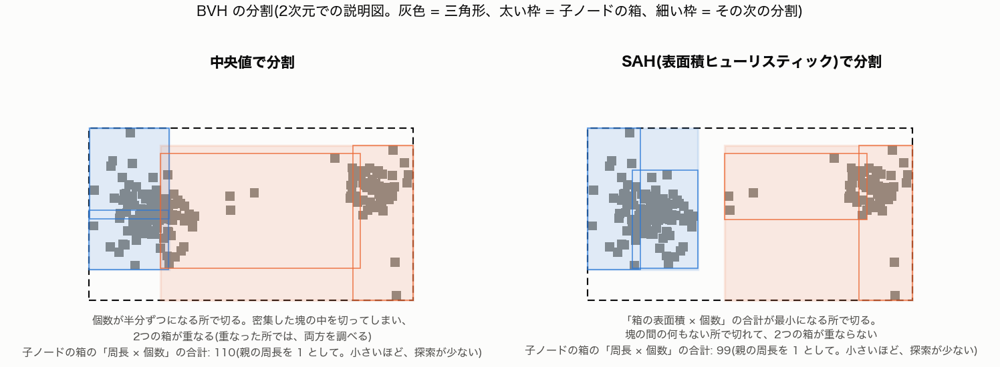

(2次元での説明図。灰色 = 三角形。太い枠 = 子ノードの箱、細い枠 = その次の分割。図は `tools/plot_m5.py`。)

- **中央値**: 個数が半分ずつになる所で切る。簡単で速く作れるが、密集した塊の真ん中で切ってしまうことがあり、2つの箱が重なる。
- **SAH**(Surface Area Heuristic): 「**箱の表面積 × 中の三角形の数**」の合計が最小になる所で切る。レイが箱に当たる確率は、表面積に比例するので、これは「レイが調べに来る三角形の数の見積もり」です。塊の間の何もない所で切れて、箱が重ならない。実装は、重心を16個のビンに分けて、各境目のコストを計算する binned SAH です。

SAH は、構築が約 2.6 倍遅い(ビートルで 約 180 ms と 約 70 ms)ですが、シーンを読み込むときの1回だけです。

### 走査の工夫

- **近い子から先に調べる**: 2つの子の箱のうち、レイに近いほうを先に調べます。そこで三角形に当たれば、それより遠い箱は、調べなくて済みます。
- **any-hit(影レイ)**: 影の判定は、「遮るものがあるか」だけ分かればよいので、**最初に見つけた交差で打ち切ります**(最近傍を探す必要がない)。Path 方式の影レイ(NEE)に使います。Whitted 式の影レイは、ガラスを通す(薄い影を作る)ので、最近傍を探したままです。

### 結果

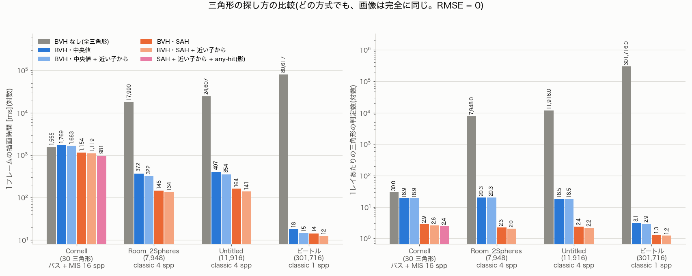

(左: 1フレームの描画時間、右: 1レイあたりに調べる三角形の数。どちらも対数の目盛り。Release、8スレッド。)

| シーン(三角形数) | BVH なし | 中央値 | SAH + 近い子から |
|---|---|---|---|
| ビートル(301,716、1 spp) | 80.6 秒 | 18.2 ms | 12.4 ms |
| Room_2Spheres(7,948、4 spp) | 18.0 秒 | 372 ms | 134 ms |
| Untitled(11,916、4 spp) | 24.6 秒 | 407 ms | 141 ms |
| Cornell(30、パス + MIS 16 spp) | 1.55 秒 | 1.77 秒 | 1.12 秒 |

- **画像は、どの方式でも完全に同じ**です(BVH なしの画像との RMSE が 0)。探し方を変えても、見つかる三角形は同じなので、絵は変わらず、時間だけが変わります。
- 三角形が多いほど、BVH の効果は桁違いに大きくなります(ビートルで約 6,500 倍)。1レイあたりに調べる三角形は、Room で 7,948 個から、SAH + 近い子からだと 2.0 個になりました。
- **三角形が30個しかない Cornell では、中央値の BVH は、総当たりより遅い**です。壁や床の大きな三角形が箱に重なって、BVH の箱がうまく絞れず、箱を調べる手間が増えるだけになるためです。SAH なら、箱の表面積を見て分けるので、少ない三角形でも勝ちます。「BVH ならいつも速い」わけではありません。
- SAH は中央値より約 2.5〜2.9 倍速く、近い子から走査でさらに 8〜15%、any-hit で Cornell がさらに約 12% 速くなりました。

### スレッド数(並列化)

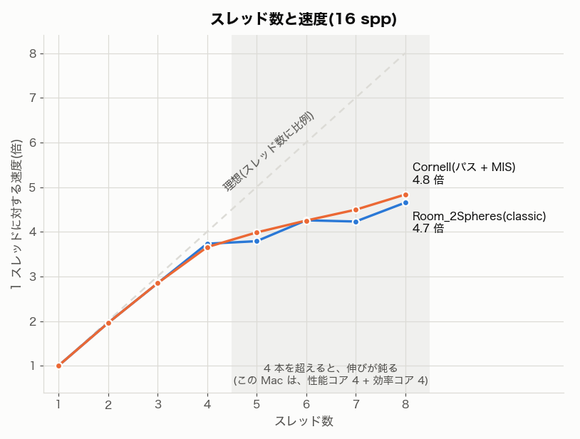

画面を走査線(行)ごとに分けて、スレッドが順番に取っていきます。乱数は (シード, ピクセル, サンプル) ごとに独立なので、**スレッド数が違っても結果は同じ**です(テストで確認)。

- 4スレッドまでは、ほぼ理想的に伸びます(効率 91% 以上)。
- それ以降は鈍り、8スレッドで約 4.7〜4.8 倍(効率 58〜60%)です。この Mac(Apple M1)は、性能コア 4 + 効率コア 4 で、4 本を超えると、速度の違うコアに仕事が回るためだと考えられます(未確認の推測)。

### まだやっていないこと

- 広い建築シーンでの比較(そのシーンがないため)。
- BVH の葉の大きさ(最大4個)や、SAH のコストの比(走査:判定 = 1:1)の調整。
- GPU や SIMD での高速化。

## 12. PBR の材質: Fresnel・GGX・ガラス(M7)

これまでの Path 方式(M2〜M5)は、すべての面を「拡散」として扱っていました。M7 で、金属・プラスチック・ガラス・鏡を区別できる材質(**PBR** = Physically Based Rendering)を入れました。旧方式は `--bsdf lambert` で残してあります。

### 材質のパラメータ(glTF / Blender と同じ)

| パラメータ | 意味 |
|---|---|
| `baseColor` | 色。金属では「鏡面の色」、非金属では「拡散の色」になる |
| `metallic` | 0 = 非金属(プラスチック、紙)、1 = 金属 |
| `roughness` | 0 = つるつる(鏡)、1 = ざらざら(つや消し) |
| `transmission` | 1 = ガラスのように光が通る |
| `ior` | 屈折率(ガラスは約 1.5)。非金属の反射率も、ここから決まる |
| `specular` | 非金属の鏡面反射の強さ(0 = ハイライトなし。Blender の書き出しにも入る) |

金属と非金属の違いは、**どれだけ反射するか(Fresnel の F0)**です。非金属は、真正面から見て 4% ほど(屈折率 1.5)しか反射せず、残りは中に入って拡散します。金属は、base color の色で、ほとんどを反射し、拡散しません。

### Fresnel: 見る角度で、反射の強さが変わる

どんな面も、**すれすれの角度で見ると、鏡のように反射します**(水面や床に写る景色を、遠くほどはっきり見るのと同じ)。

- 非金属(IOR 1.5): 真正面で 4%、すれすれで 100%。
- ガラスは、厳密な式(偏光なしの Fresnel)を使い、**反射する確率 = F、屈折する確率 = 1 − F** で、経路を分けます。
- その他の面は、計算の軽い Schlick の近似 `F = F0 + (1 − F0)(1 − cosθ)⁵` を使います(厳密式との差は最大 0.035)。

### マイクロファセットと GGX: roughness の正体

つやのある面を、**小さな鏡の集まり(マイクロファセット)**と考えます。小さな鏡の向きのばらつきが、roughness です。

- **D(法線の分布)**: どの向きの小さな鏡が、どれだけあるか。GGX(Trowbridge–Reitz)を使い、`alpha = roughness²` で形を決めます。roughness が小さいほど、鏡の向きがそろい、反射の山が鋭くなります。
- **G(影と隠れ)**: 小さな鏡どうしが、光や視線を遮る分の補正。すれすれの角度で効きます。
- 鏡面の値 = `F × D × G / (4 cosθo cosθi)`。

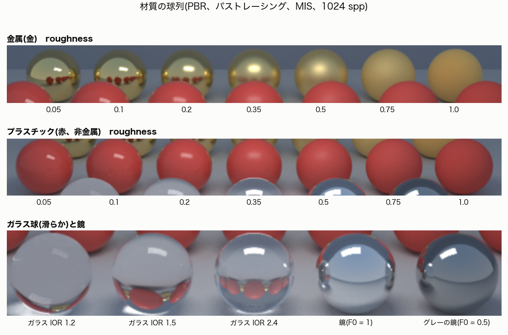

(上: 金属、中: プラスチック、下: ガラスと鏡。金属は、roughness が小さいほど周囲を鮮明に映し、大きいほど、ぼやけて、つや消しになる。プラスチックは、白いハイライトが乗った赤い球で、roughness が大きいほどハイライトが広がる。ガラス球は、屈折で、周りの景色が逆さに、球の中に写る。IOR が大きいほど、強く曲がる。)

サンプリングは、**見える法線のサンプリング(VNDF)**を使います。視線から見える向きの小さな鏡だけを、確率的に選ぶ方法で、無駄な(見えない向きの)サンプルが出ません。選ぶ確率(PDF)が分かるので、MIS の重みにも使えます。

### 拡散と鏡面を、エネルギーを増やさずに足す

プラスチックは、「鏡面の反射(薄い層)」と「その下の拡散」の組み合わせです。単純に足すと、**入ってきた光より、出ていく光が多くなる**ことがあります。

- glTF の仕様どおりの式(拡散に `1 − F(v·h)` を掛けて、鏡面を足す)は、すれすれの角度で、**方向アルベド(反射する光の割合)が 1.4 まで上がりました**(roughness 0.2、84°、数値積分で確認)。
- そこで、鏡面ローブが、その方向から見たときに反射する割合 **Es(cosθ)** を、起動時に数値で表(LUT)にしておき、拡散の重みを **`(1 − Es(wo)) (1 − Es(wi)) / (π (1 − Ē))`** にしました(`Ē` は Es の平均)。拡散は、「鏡面が反射しなかった分」だけを担当します。これで、拡散 + 鏡面の合計が 1 を超えず、入れ替えても同じ値(相反性)になります。全角度で、最大 1.0002 でした。

### 多重散乱: 粗い金属が暗くなる問題

小さな鏡の集まりで、光が**2回以上反射する**ことがあります(隣の小さな鏡で、もう一度反射)。GGX の式は、1回しか数えません(単一散乱)。そのため、**粗い金属は、光を失って、暗くなります**。

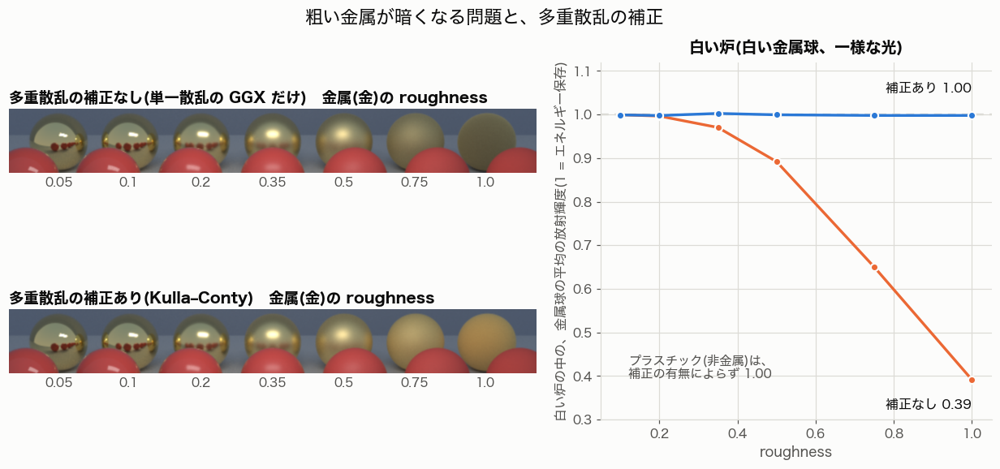

(左: 金属(金)の roughness を変えた球列。上 = 補正なし、下 = 補正あり。右: 白い炉の実験。)

**白い炉**は、一様な明るさ(放射輝度 1)の中に、白い球を置く実験です。エネルギーを保存するなら、球の明るさも、ちょうど 1 になります(増えも減りもしない)。

| 白い球の材質 | 補正なし | 補正あり |
|---|---|---|
| 完全な鏡 | 0.9996 | - |
| ガラス(IOR 1.5) | 1.0000 | - |
| 金属 roughness 0.5 | 0.892(11% 暗い) | 0.9995 |
| 金属 roughness 0.75 | 0.650(35% 暗い) | 0.998 |
| 金属 roughness 1.0 | 0.392(61% 暗い) | 0.998 |
| プラスチック roughness 0.1〜1.0 | 0.9987〜0.9999 | 同じ |

多重散乱の補正(Kulla–Conty 2017)は、失った分を、拡散に似た「余弦の山」として足します。足す量は、「GGX の反射の割合 E」と「F の平均」から、式で決まります。Blender の Principled BSDF(Multiscatter GGX)も、同じ種類の補正をしています。補正で、金属の列の平均が約 20% 明るくなりました(roughness 1.0 の球では約 2.5 倍)。

### 鏡とガラス: delta 成分

鏡とガラスは、反射(や屈折)の向きが、**1つに決まります**(delta 分布)。そのため、次のように扱います。

1. 光源サンプリング(NEE)は、しません(光源へ向かう方向を、鏡が選ぶことはできない)。
2. その後で光源に当たったら、**MIS の重みなしで、100% 足します**(M4 の残りだった「delta 成分での MIS の分岐」)。分岐しないと、鏡に映った光源が消えます。
3. ガラスは、Fresnel の確率で反射し、そうでなければ、スネルの法則で屈折します(全反射も処理)。屈折のとき、放射輝度を `(n_i / n_t)²` 倍します(ガラスに入るときと出るときで、打ち消し合います)。

制約:

- **粗いガラス(つや消しガラス)は、未対応**です(滑らかなガラスとして扱う)。
- ガラスは、影の判定では、完全な遮蔽物です。ガラス越しの光は、光源サンプリングでは拾えず、BSDF サンプリングだけが拾います(**コースティクス**は、ざらつきます。M6 のフォトンマッピングの題材です)。
- ガラスの色(base color)は、境界を通るたびに掛かります(体積の減衰ではない)。

### 光沢のある面での MIS(M4 の予想の確認)

M4 で「つやのある面で、MIS の本領が出るはず」と書きました。材質が入ったので、確かめました。

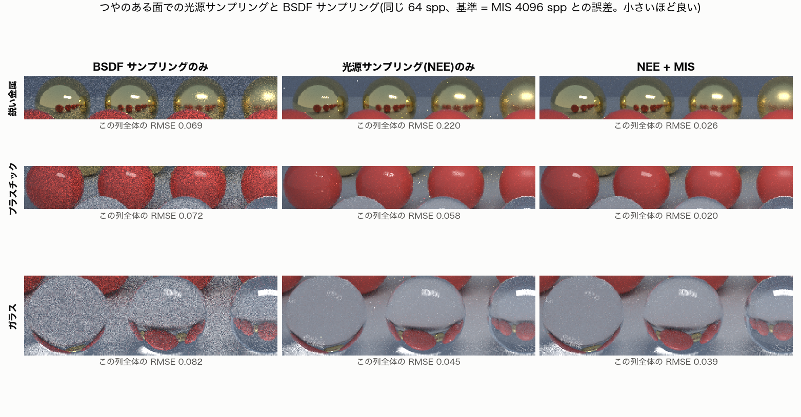

(同じ 64 spp。数字は、各列全体の、基準画像(MIS 4096 spp)との RMSE で、小さいほど良い。)

- **鋭い金属**: 光源サンプリング(NEE)のみが最悪(RMSE 0.22。光の反射は、細い山に集中しているので、光源へ向かう方向を選んでも、BSDF の値がほとんど 0)。BSDF サンプリングは、そこでは安定(0.069)。
- **プラスチック**: 拡散が主なので、BSDF サンプリングは光源に当たりにくく、劣る(0.072)。NEE は良い(0.058)。
- **MIS は、どちらでも最良**(0.026 と 0.020)。256 spp の全体では、BSDF のみの約 1/3.4、NEE のみの約 1/5。

### 3つの方式を並べると

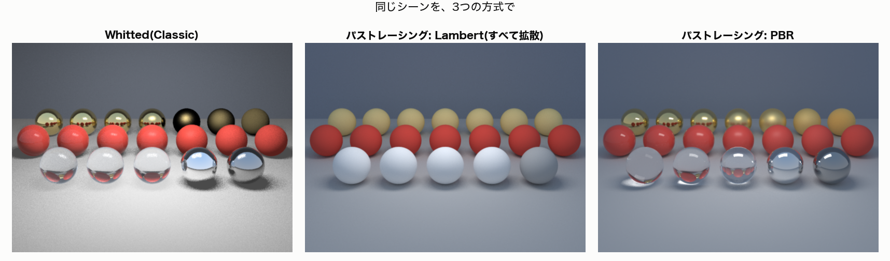

- Whitted(Classic): 粗い金が、黒く沈みます(Classic のスペキュラは、金属の拡散を 0 にして、ハイライトだけ足すため)。床や壁の間接光もありません。
- パストレーシング(Lambert): 全部が拡散。金属もガラスも、つや消しの球に見えます。
- パストレーシング(PBR): 金属・プラスチック・ガラス・鏡が、区別できます。周囲(空の光、壁、他の球)が、球に映ります。

### 正しさの確かめ方

- **数値積分との一致**: BSDF の値(`eval`)、確率(`pdf`)、サンプリング(`sample`)が、同じ分布を表していること。サンプルの重みの平均が、半球の積分と一致すること。
- **エネルギー**: 全角度で、方向アルベドが 1 を超えないこと。白い炉で、1 に近いこと。
- **スネルの法則**と、ガラス板越しの光のずれ(正しく屈折したときだけ、小さな光源が見える)、Fresnel による減衰。
- **3方式(BSDF のみ / NEE / MIS)の期待値が、光沢のある面・ガラス越しでも一致すること**(二重計上や、取りこぼしがないこと)。
- わざとバグを入れて、テストが失敗することを確認しました(拡散の結合を glTF 式に戻す、屈折率の向きを逆にする、VNDF の確率から G1 を外す、多重散乱の項を落とす)。

### Blender(Cycles)との比較

材質のパラメータ(metallic・roughness・IOR など)が、Blender と同じ意味になっているかを確かめるため、**同じシーンを Cycles でも描いて**比べました(別プロセスの画面なし Blender 5.2。光源は同じ放射輝度の発光する矩形、空は同じグラデーション、カメラと解像度も同じ、1024 spp)。

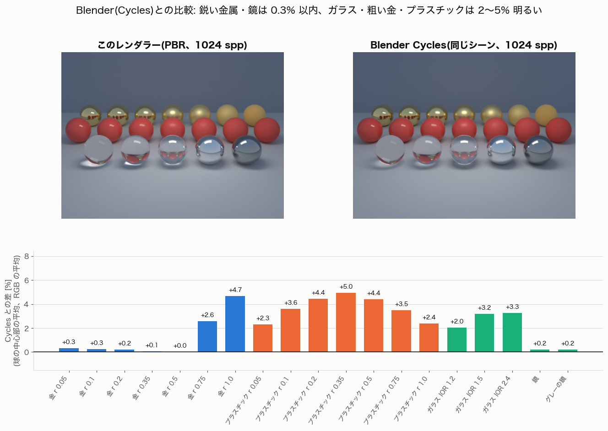

(下のグラフ: このレンダラーが Cycles より何 % 明るいか。球の中心部の平均。)

- **鋭い金属(roughness 0.5 以下)と鏡は、0.3% 以内で一致**しました。roughness → alpha = roughness² の対応、金属の色、鏡の Fresnel、光源と空の較正が、Blender と合っています。
- 粗い金(roughness 0.75 と 1.0)は +2.6% と +4.7%、プラスチックは +2〜5%、ガラスは +2〜3% 明るく出ます。
- 「Blender の非金属は、Schlick ではなく厳密な Fresnel を使うからでは」という仮説を確かめるため、鏡面を厳密な Fresnel にして描き直しました。**差は縮まらず、わずかに増えました**。仮説は外れです。
- 残る数 % の原因は、**未解決**です(拡散と鏡面の結合の違い、多重散乱の補正式の違い、ガラスの集光の違い、などが候補。どれも未確認)。

### 速度と見た目の違い: Cycles と自作レンダラ(2026-10-17)

「Blender のレンダリングは速くてきれい」という感覚が、どこから来るのかを調べました。結論は、**少なくともこのシーンでは、1 サンプルあたりの速さで Cycles が勝っているわけではなく、少ないサンプルできれいに見せる仕組みが主な理由らしい**です(インターフェイスの工夫も、効いている可能性があります。下の「測っていないこと」)。

**測ったこと**(同じカメラ、640x480、反射の最大回数 8、64 spp、M1 の 8 コア、Release。ビートルのシーン。**他の処理を同時に走らせずに**測った):

| | 時間 | 条件 |
|---|---|---|
| Cycles(CPU) | 45.9 s、44.3 s(2 回) | デノイズなし、適応サンプリングなし。**シーンの準備(テクスチャの読み込み、BVH 構築)を含む** |
| 自作レンダラ | 9.1〜9.6 s(12 回の範囲、中央値 9.3 s) | `--repeat 3` を 4 組。読み込み(1.5〜2 s)は含まない。法線マップのあり・なしで差はない |

- **訂正(2026-10-17)**: この節の最初の版は、Cycles が 42.1 s、自作レンダラが 25.9 s と書いていた。**この 2 つの描画を同時に走らせて**(同じターンで、別々のツールが並行して動いた)、8 コアを取り合っていた。数値は誤りで、上の表(単独で測り直した値)に置き換えた。元の版では、「時間が spp に比例していない」とも書いたが、それも同じ原因(他の処理との競合)だったと考えている(`--repeat` で測ると、揺れは約 ±3%)。**時間は、必ず単独で、`--repeat` で測る**。
- **この表から「自作のほうが速い」とは言えない**: Cycles 側は、4096² のテクスチャ(UDIM の 6 タイル × 数種類)、法線マップ、空の光、ガラスを含み、**準備の時間(分けられていない)も入っている**。自作側は、2048² に縮めたアトラス、1 つの面光源だけで、扱う機能がはるかに少ない。**同じ spp でも、1 サンプルの質は同じではない**。確かに言えるのは、「**このシーンの 64 spp(デノイズなし)では、準備を含む Cycles の時間のほうが、自作の描画時間より長かった**」ことまで。
- 自作側の光線数は、256 spp で約 6.45 億本(1 回の描画)。Cycles の光線数は測っていない。
- Cycles の 256 spp(CPU)と GPU(Metal)は、通信が切れて測れなかった(GPU は、更新時刻から約 68 s と推定できるが、初回のカーネルのコンパイルが混ざっている可能性があり、信頼できない)。

**この Blender のシーンの Cycles の設定**(実際に読んだ値): デノイザー = OpenImageDenoise(有効)、適応サンプリング = 有効(しきい値 0.01)、サンプリングパターン = AUTOMATIC、ライトツリー = 有効、間接光のクランプ = 10、`blur_glossy`(艶のぼかし)= 1.0、**コースティクス(反射・屈折)= 有効**、最大反射 12 回、GPU(Metal)は有効だが、シーンのデバイスは CPU。

**違い**(上の設定の部分は確認済み。それ以外は一般的な知識で、このレンダラーでは測っていない):
1. **デノイザー**: ノイズの多い絵を、AI でなめらかにする。**少ない spp できれいに見える、最大の理由と考えられる**(切り分けの実験はしていない)。自作側にはない。
2. **適応サンプリング**: ノイズの少ない部分は早く打ち切り、サンプルを難しい部分に回す。自作側は、全ピクセルに同じ数を使う。
3. **偏りを許す工夫**: 間接光のクランプ(明るすぎる 1 サンプルを切る)、艶消しのぼかし(`blur_glossy`)。ホタルや鋭い反射のノイズを減らすが、わずかに偏る(バイアス)。自作側は偏りがない代わりに、ノイズが残る。
4. **サンプルの質**: ノイズの出にくい乱数列(Sobol 系など)を使う。自作側は、ピクセルごとに独立の乱数(PCG32)。
5. **BVH と GPU**: Cycles の CPU 側は、SIMD などで最適化された BVH ライブラリ(Embree)で、GPU も使える。自作側は、読みやすさを優先した、1 本ずつの計算。
6. **機能の広さ**: 体積、SSS、髪、モーションブラー、複雑な材質、ミップマップ付きテクスチャなど。

**訂正**: 窓ガラスのノイズ(白い粒)について、「Cycles はコースティクスがオフだから少ない」と考えていたが、**このシーンではコースティクスはオン**だった。Blender の絵がきれいなのは、主にデノイザーと間接光のクランプなどによる、と考えている(切り分けの実験はしていない)。

**測っていないこと**: Blender のビューポートのレンダープレビュー(段階的に絵が精細になり、デノイズされる)は測っていない。「速く感じた」のは、この種の、段階表示・デノイズ・適応サンプリングなどの**インターフェイス側の工夫**によるのかもしれない(**推測**)。自作レンダラーも、ウィンドウでは段階描画(第8章)をするが、デノイザーはない。

**取り入れるなら**(コードを単純に保つ方針で、候補): 適応サンプリングと間接光のクランプは、どちらも数十行で入る(どちらも**未実装**)。デノイザーは、外部ライブラリが要るので、自作の方針とは合わない。

### 法線マップ(テクスチャの一種。M8)

- **何をするか**: 面の細かい凹凸(革のしぼ、タイヤの刻印、金属の彫り)を、**形は変えずに**、「面の向き(法線)」だけを画像で変えて表します。光の当たり方(陰影、ハイライトの形)が変わるので、凹凸があるように見えます。輪郭や影の形は、変わりません(三角形のままだから)。
- **画像の中身**: 各画素の (R, G, B) を、(x, y, z) = (R, G, B) × 2 − 1 の向きと読みます。**タンジェント空間**: 面の「上向き」(元の法線 n)が z、テクスチャの横方向(u の増える向き = 接線 t)が x、画像の上方向(bitangent b)が y です。何もない平らな所は、(0, 0, 1) = 色で (128, 128, 255) の、薄い青紫です。
- **このレンダラーの計算**: ヒットした点で、n' = x t + y b + z n を、新しい法線にします(`applyNormalMap`)。t と b は、**読み込み時に、UV から**求めます(三角形ごとに dP/du と dP/dv を出し、頂点に平均して、法線に垂直にする)。
- **規約が 2 つある**: 画像の緑(y)が「上」か「下」か(OpenGL は上、DirectX は下)。glTF と Blender は OpenGL の規約(y = 画像の上)で、ここもそれに従います。逆にすると、凹凸が反転して見えます。UV が鏡像の所は、b の向きを反転する(手の向き w)。
- **確かめ方**: 合成の法線マップ(4 つの象限が、それぞれ別の向きに傾く)を Blender で書き出し、Blender 自身が計算した法線と、このレンダラーの法線を比べました。テクセルの中心で、角度の差は中央値 2.9°(最大 4.2°)で、緑を反転すると約 37° でした。向きの規約は、Blender の書き出しを通しても、合っています。
- **ビートルでは、効果が小さい**: このモデルの法線マップは、見えている範囲でほぼ平らです。タイヤの溝は、法線マップではなく、実際のジオメトリです(タイヤだけで 10 万ポリゴン)。画像で大きな違いが出るのは、凹凸を法線マップで表したモデルです。
- 未対応: ミップマップ(遠くの細かい凹凸がちらつく)、MikkTSpace の接線。

### まだやっていないこと

- 粗いガラス(つや消し)、体積の減衰、クリアコートと表面下散乱(考え方は[第13章](#13-層のある材質-クリアコートと表面下散乱考え方未実装))。テクスチャは、baseColor と metallicRoughness だけ M8 で対応した。
- Cycles との数 % の差の原因の調査。
- ガラスのコースティクス(M6)。

## 13. 層のある材質: クリアコートと表面下散乱(考え方。未実装)

第12章の PBR は、「1 つの表面で、拡散と鏡面を足す」材質でした。現実の材質には、表面の**上**に層があるもの(車の塗装)と、**中身**が半透明なもの(皮膚、蝋)があります。どちらも、光が「表面の下」に入る点は同じですが、起きることが違います。**このレンダラーは、どちらも未対応**です(Blender の Principled BSDF や glTF には、パラメータがあります)。この章は、考え方の説明です。数値は、図も含めて、模式的な例で、測ったものではありません。

### 拡散は、実は「とても短い距離の散乱」

第5章の拡散反射(Lambert)は、「光が表面のごく浅いところで散って、同じ点から出てくる」と見なしています。実際は、顔料や繊維の中で光が何度か散ってから出てくるので、**入った点と出る点が、ほんの少しずれています**。そのずれが、画面の 1 ピクセルよりずっと小さければ、「同じ点から出る」と見なして、その 1 点だけで計算できます。これが拡散です。

### クリアコート(Coat): 透明な層で、反射がもう 1 回起きる

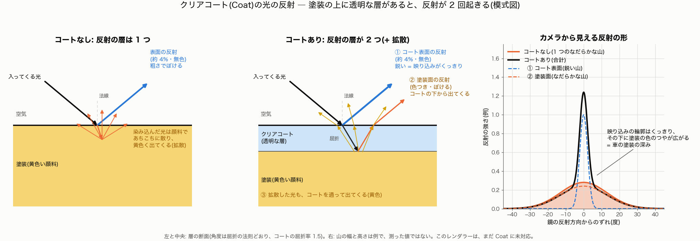

- 塗装の上に、**透明な層**(クリアコート)が乗っています。光は、コートの中では散らず、**ほぼまっすぐ通り抜けます**(出入りで、屈折の法則どおりに折れ曲がるだけ)。
- 反射が 2 回起きます。
  1. **コート表面の反射**(真正面から約 4%、無色、roughness が低いので鋭い)。映り込みが、くっきりします。
  2. **塗装面の反射**。コートを通り抜けて、塗装面(ここも roughness を持つ)で反射し、またコートを通って出てきます。色がつき、ぼけます。拡散した光(黄色)も、同じようにコートを通って出てきます。
- カメラから見ると、**鋭い山(①)の下に、塗装の色のなだらかな山(②)が広がる**形になります(図の右)。これが、車の塗装の「深み」です。コートがないと、なだらかな山だけです。
- エネルギーの保存: コート表面で反射した分(約 4%)だけ、下の層に届く光が減ります。実装では、下の層を `(1 − コート表面の Fresnel)` で弱めるのが、一般的な近似です(入るときと出るときの両方)。
- Blender の Principled BSDF では **Coat Weight**(強さ)、**Coat Roughness**、**Coat IOR**、**Coat Tint**(コートの色)。glTF には、拡張 `KHR_materials_clearcoat` があります。
- このレンダラーに入れるなら: 第12章の GGX の鏡面ローブを、**もう 1 つ**(コート用の roughness と屈折率)足し、下の層を弱める、という形になるはずです(**計画で、未実装**。光源サンプリングと BSDF サンプリングの両方に、ローブが 1 つ増える)。
- 購入したビートルのモデルには、Coat は設定されていません(取り込んだ Blender のマテリアルで、Coat Weight = 0 を確認)。つやは、塗装の roughness(0.051)の鋭い鏡面だけです。

### 表面下散乱(Subsurface Scattering、SSS): 別の場所から出る

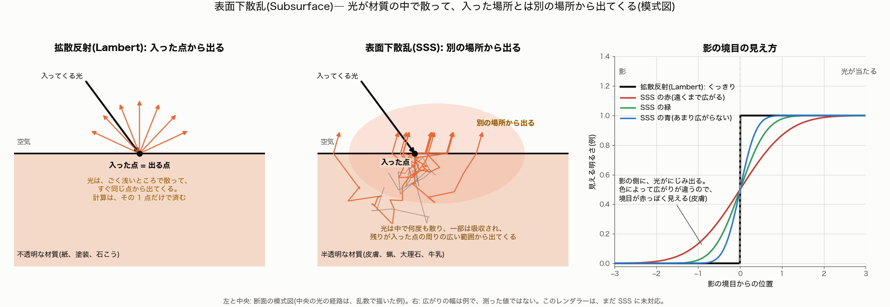

- 物体の**中身そのものが、半透明**です。光は中に入り、内部で**何度も散って**(一部は吸収されて)から、**入った点の周りの広い範囲**から出てきます(図の中央)。
- 見た目への効果は、**陰影がにじむ**ことです。影の境目がぼけ、光が回り込みます(図の右)。散る距離は**色(波長)によって違い**、皮膚では赤がいちばん遠くまで広がるので、影の境目が赤っぽく見えます。蝋、大理石、牛乳、葉、ジェイドも、この種類です。
- 計算の難しさ: 拡散は「入った 1 点」で済みますが、SSS は**出る点が別の場所**で、その分布を扱う必要があります。主なやり方は 2 つです。
  1. **内部のランダムウォーク**: 物体の内側で、光を実際に何度も散らして、出てくる点を見つける。正確だが、重い(物体の内側の形が必要)。
  2. **BSSRDF(拡散近似)**: 「入った点から、距離 r だけ離れた点から出る確率」の分布(プロファイル)をあらかじめ決めておき、出る点をその分布でサンプリングする。軽い近似。
  Blender の Cycles には、どちらの系統の方式もあります(Christensen–Burley と Random Walk)。Principled BSDF では **Subsurface Weight**、**Subsurface Radius**(色ごとの広がり)、**Subsurface Scale** など。glTF には、SSS の標準的な拡張は、私の知る限りまだ確定していません(この文書では未確認)。
- このレンダラーに入れるなら、(1) か (2) のどちらかが必要で、コートよりずっと大きな変更になるはずです(**計画で、未実装**)。

### 3つの違い

| | 拡散(Lambert) | クリアコート(Coat) | 表面下散乱(SSS) |
|---|---|---|---|
| 光の入り方 | 浅いところで散る | 透明な層を、ほぼ直進で通る | 内部で何度も散る |
| 光が出る場所 | **入った点** | 入った点の近く(屈折でわずかにずれるだけ) | **入った点の周りの広い範囲** |
| 追加される反射 | なし | **反射がもう 1 回**(コート表面) | なし(陰影がにじむ) |
| 見た目 | 均一なマット | くっきりした映り込み + 色のつや(深み) | 柔らかく、光が透けてにじむ |
| 例 | 紙、石こう、つや消しの塗装 | **車の塗装**、つやのある木工品 | 皮膚、蝋、大理石、牛乳、葉 |
| このレンダラー | **対応(第5章)** | 未対応 | 未対応 |

ビートルの塗装には、コート(層が 1 つ増える)が合っていて、SSS(中身が半透明)の出番はありません。

### まだやっていないこと

- クリアコートの実装(第2のスペキュラーローブ、下の層の減衰)。
- 表面下散乱の実装(ランダムウォーク、または BSSRDF)。
- 他のパラメータ(Sheen、異方性、薄膜、発光、Alpha)も未対応。

## 14. 用語集

| 用語 | 意味 |
|---|---|
| レイ | 原点と方向を持つ光線。レイ1本が放射輝度の値を運ぶ |
| spp | samples per pixel。1ピクセルで平均する経路の数 |
| 放射輝度 | ある点から、ある方向へ出る光の明るさ |
| 放射照度 | ある面が全方向から受ける光の量 |
| 拡散(ランバート) | 表面の凹凸で光が散らばり、見る方向によらず同じ明るさに見える面 |
| アルベド | 面の反射率(吸収されずに反射される割合)。色で表す |
| BSDF | ある方向から来た光が、別の方向へどれだけ出るかを表す関数。材質の性質 |
| PDF | 確率密度関数。ある方向(や点)を選ぶ確率の密度。寄与を割って補正する |
| モンテカルロ法 | ランダムなサンプルの平均で、積分(明るさ)を見積もる方法 |
| 期待値 | サンプルを無限に増やしたときの平均(収束先の絵) |
| バイアス | 期待値が、正しい答えとずれていること(例: 反射回数の上限で暗くなる) |
| 分散・ノイズ | サンプルのばらつき。誤差は 1/√N で減る |
| NEE | 反射点から光源へ直接シャドウレイを飛ばす、直接照明の見積もり方 |
| MIS | 複数のサンプリング方法を、重み(Power Heuristic など)を付けて組み合わせる方法。このレンダラーでは、光源サンプリングと BSDF サンプリングを組み合わせる(既定) |
| Russian Roulette | 確率で経路を打ち切り、続ける分を 1/p 倍して補正する方法(バイアスなし) |
| delta 分布 | 方向が1つに決まる反射(完全な鏡など)。PDF が1点に集中する |
| 二重計上 | 同じ光を2回数えること。絵が明るすぎるバグになる |
| 反射レイ | 面で反射して、次の点へ進むレイ(BSDF サンプリングで方向を選ぶ)。間接光を運ぶ |
| シャドウレイ | 反射点から光源の点へ直接飛ばすレイ(NEE)。遮られていなければ直接光を拾う |
| Fresnel(フレネル) | 見る角度で、反射の強さが変わる現象。すれすれの角度では、どんな面も鏡のように反射する |
| F0 | 真正面から見たときの反射率(非金属は約 4%、金属は色つきで高い) |
| マイクロファセット | 面を、向きのばらついた小さな鏡の集まりと考える見方。roughness は、そのばらつき |
| GGX | マイクロファセットの向きの分布の一種(Trowbridge–Reitz)。山の裾が長く、実物に近い |
| VNDF | 視線から見える向きの小さな鏡だけを選ぶサンプリング |
| 多重散乱 | 小さな鏡の間で、光が2回以上反射すること。GGX の式は1回しか数えないので、補正で足す |
| 白い炉 | 一様な明るさ(1)の中に白い球を置き、エネルギー保存を確かめる実験 |
| delta 成分 | 反射・屈折の向きが1つに決まる成分(鏡、滑らかなガラス)。光源サンプリングでは選べない |
| コースティクス | ガラスなどで屈折・反射した光が、床などに集まってできる明るい模様 |
| クリアコート(Coat) | 塗装の上の透明な層。コート表面の鋭い反射と、下の層の反射の 2 つが見える(第13章) |
| 表面下散乱(SSS) | 光が材質の中で何度も散って、入った点とは別の場所から出てくる現象。皮膚・蝋・大理石など(第13章) |
| デノイザー | ノイズの多い画像を、AI などでなめらかにする後処理。少ない spp できれいに見せる(Cycles は OpenImageDenoise) |
| 適応サンプリング | ノイズの少ないピクセルは早く打ち切り、サンプルを難しい部分に回す方法 |
| クランプ | 明るすぎる 1 サンプルの値を切る処理。ホタルを減らすが、わずかに暗くなる(バイアス) |
| 法線マップ | 面の向き(法線)を画像で変えて、形を変えずに凹凸の陰影を出すテクスチャ。(R, G, B) × 2 − 1 = タンジェント空間の向き(第12章) |
| タンジェント空間 | 面の上向きの法線 n、横方向の接線 t、もう一つの方向 b で作る座標系。法線マップは、この座標系で書かれる |
| BSSRDF | 「どこから入った光が、どこから出るか」を表す関数。BSDF は入った点と出る点が同じ。SSS の近似に使う |
| 屈折(スネルの法則) | 光が、屈折率の違う物質の境目で折れ曲がること。`sin θ₁ / sin θ₂ = n₂ / n₁` |
| BVH | 三角形を箱で包み、箱を階層にした構造。レイが当たらない箱の中は、まとめて飛ばせる |
| SAH | 「箱の表面積 × 三角形の数」が最小になる所で箱を分ける方法(Surface Area Heuristic) |
| any-hit | 「遮るものがあるか」だけを調べ、最初の交差で打ち切る探索。影レイに使う |
| ホタル(firefly) | 確率の低い方向がたまたま選ばれて、寄与が異常に大きくなった、画面上の明るい点 |
| カラーブリーディング | 色のついた面からの反射光が、周りの面に色を移す現象 |
| プログレッシブ描画 | サンプルを段階的に足しながら、途中の画像を表示する描き方 |
| film | 線形の放射輝度の合計とサンプル数を保持するバッファ |
| RMSE | 2つの画像の差の大きさ(二乗平均平方根)。基準画像との誤差の指標 |
