# WorkLog

新しいものを上に書く。書き方は [WORKFLOW.md](WORKFLOW.md) を参照。

## 2026-10-15

### まとめと次の一手(この日の終わり)
- 完了: M0・M1・M2・M3、M4 のうち NEE。ズーム・パン、Release ビルドの整理(`build-release/`)。テスト 288 項目。
- 未確認: ウィンドウでの実機操作(設定変更の自動リセット、+ samples)。M2〜M3 の実験の時間は Debug の値(Release で測り直す)。
- 次: M4 の残り(Russian Roulette → PDF の計算と MIS)。Path 方式に鏡・ガラスを入れる(delta 成分の分岐)のは、そのあと。

### 解説ドキュメントと BSDF サンプリングの図
- 開発中の疑問(spp とノイズ、放射輝度、Whitted と Path の違い、拡散面の散乱、BSDF、NEE が嘘でない理由、プログレッシブ、ビルドの種類、M4 の残り)を、[RENDERING_GUIDE.md](RENDERING_GUIDE.md) にまとめた。用語集つき。
- 反射方向の選ばれやすさの図(拡散面 / 鏡 / つやのある面。面の断面、線の長さ = 選ばれやすさ)。拡散面は法線方向がピーク(確率 ∝ cos θ、ピーク 0.32)、鏡は反射方向の1本だけ、つやのある面は鏡面反射の方向に集中(Phong 型 n = 40 の例、ピーク 6.5)。3つは形を比べやすいよう最大の長さをそろえて描いてある。いまの Path 方式が使うのは、拡散面だけ。鏡・つやのある面は M7 で入る。描画は `tools/plot_bsdf_sampling.py`(matplotlib が必要)。

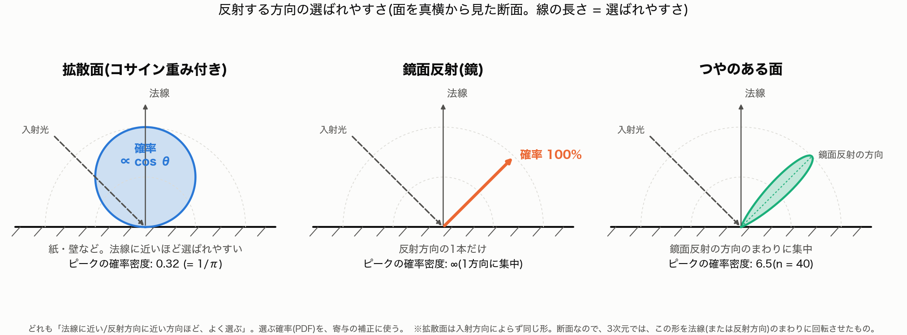

### ビルドの種類(Debug だった)
- **発見**: `build/` は `CMAKE_BUILD_TYPE=Debug`(`-g` だけ、最適化なし)で設定されていた。CMakeLists は未指定のときだけ Release にするので、指定済みの Debug がそのまま使われていた。**M2・NEE・M3 の実験の描画時間(WORKLOG の下の記録)は、すべて Debug の値**。M0 の基準(`experiments/2026-10-15_baseline/`)は、JSON に Release と記録されている。
- **測定**(Cornell Box、path、8回反射、ジッタ、16 spp、同じ画像): Debug 34.3 s、Release(`-O3 -DNDEBUG`)3.1 s → **約11倍**。画像はバイト単位で同一。
- **Release での目安**(8スレッド、他の処理が少し動いていたので ±数割の誤差): 256 spp で、NEE あり約 26 s、NEE なし約 17 s(サンプルあたり約1.5倍。Debug での比と一致)。段階描画の 256 spp も、同程度のはず(未計測)。
- 実験の**画像と RMSE は、ビルドの種類に依存しない**(同じ画像)。時間だけ、Release で測り直す必要がある。
- Release は別のディレクトリで確認した(`cmake -S . -B <dir> -DCMAKE_BUILD_TYPE=Release`)。`build/`(Debug)はそのまま残し、リポジトリ内に **`build-release/`**(Release、`.gitignore` 済み)を追加した。README・CURRENT_IMPLEMENTATION・WORKFLOW に、使い分け(描画・計測・テストは `build-release/`、デバッグは `build/`)を書いた。新しい実験の `run.sh`(M2・M3・M4)は `build-release` を使う(`RAYTRACE=...` で変更可)。

### M3(プログレッシブ描画)
- **実装**: `RenderSettings::firstSample`(サンプル番号の通し番号)、`nextPassTotal()`(1→4→16→64→…→目標)、`RenderJob` のパス処理(各パスの後に画像を公開 `copySnapshot()`、`extend()` でリセットなしの追加、キャンセル後は追加不可)、GUI(進捗、`+ samples`、設定変更で自動リセット、ウィンドウの既定はプログレッシブ)、`--progressive`(各パスの PNG を保存)。
- **テスト**(288項目、すべて成功): パスの分け方(スケジュール)、パスに分けても一括描画と**ビット単位で同一**のフィルム、公開された画像がフィルムの平均と一致、`extend()` で 4 + 12 = 16 spp が 16 spp の一括描画と同一、キャンセル後の追加の拒否。
- **実験** `experiments/2026-10-15_m3-progressive/`(Cornell Box、NEE、8回反射、ジッタ、シード 1、256 spp): パスの完了時刻(累積)は 1 spp = 1.0 s、4 = 4.3 s、16 = 16.9 s、64 = 68.4 s、256 = 286.3 s。**段階描画と一括描画(345.6 s)の PNG は、バイト単位で同一**。初めの数秒で全体の様子が分かり、その後ノイズが減っていく(画面での確認は、スクリーンショットの連番)。
- **観察**: 段階描画は、一括描画より遅くならなかった(今回は、他の作業と並行していたので、時間は参考値)。1 spp の画像で、すでに構図・色移りが分かる。
- **スクリーンショット**: `docs/screenshots/2026-10-15_cornell-progressive-nee-{1,4,16,64,256}spp.png`。
- **未確認**: ウィンドウでの実機操作(設定を変えたときの自動リセット、+ samples の押下)は、人間の目では未確認。GUI の自動テスト(Render ボタンと露出スライダー)は通っている。
- PFM(線形画像)は、実験フォルダから消した(再生成は `run.sh`。RMSE の計算には、PFM を残す必要がある)。

### NEE(次イベント推定)— M4 の最初の一歩
- **実装**: `sampleDirectLight()`。各反射点で光源上のランダムな点にシャドウレイを飛ばし、`アルベド/π × 放射輝度 × cos(面) × cos(光源) × 面積 ÷ 距離²` を足す。BSDF サンプリングの経路が光源に当たっても足さない(二重計上の回避。カメラレイが直接見る場合だけ足す)。反射回数の上限ごとに、NEE なしと同じ期待値になるようにした。`--no-nee` / パネルのチェックで M2 の方式に戻せる(既定はオン)。
- **テスト**(259項目、すべて成功): 数値積分の解析値との一致、NEE あり/なしで反射回数 1・2・3 の期待値が一致(標準誤差の5倍以内)、ノイズが3倍以上小さい。
- **実験** `experiments/2026-10-15_m4-nee/`(Cornell Box、8回反射、ジッタ、基準 = NEE 1024 spp・別シード): 基準画像との RMSE(NEE あり / なし)は、1 spp で 0.179 / 0.819、4 spp で 0.093 / 0.410、16 spp で 0.047 / 0.205、64 spp で 0.025 / 0.103、256 spp で 0.013 / 0.052。**同じ spp で、誤差は約 1/4**(= 同じ誤差に必要なサンプルは約 1/16)。
- **同じ時間では**: NEE はサンプルあたり約 1.5 倍遅い(256 spp: 274 s / 183 s、他の作業と並行していたので参考値)。それでも NEE の 16 spp(18 s、RMSE 0.047)は、NEE なしの 256 spp(183 s、RMSE 0.052)と同等で、**約 10 倍速い**。
- **観察**: どちらも 1/√N で減る(4倍で半分)。NEE は直接光のノイズを消すので、残るのは間接光のノイズ。画像は、同じ絵に収束する(基準との差が単調に減る)。
- **残り(M4)**: BSDF 側のサンプリングとの組み合わせ(MIS)、Importance Sampling。鏡面・ガラスは未対応。
- **スクリーンショット**: `docs/screenshots/2026-10-15_cornell-path-nee-8bounce-*.png`(NEE)、`...-no-nee-*`(NEE なし)。

### GUI: 画像の拡大縮小
- ノイズを細かく見るため、画像表示をズーム・パンできるようにした(スクロール/ホイールでカーソル中心のズーム、ドラッグで移動、ダブルクリックで全体表示、Fit / 100〜800% ボタン、100% 以上は補間なし)。カーソル下のピクセルの線形 RGB とサンプル数も表示。ウィンドウに一時的にホイール操作を注入して動作を確認した(308% でピクセルがくっきり表示され、値も出る)。

### M2(最小のモンテカルロ・パストレーシング)
- `pathTrace()`: Lambert、コサイン重み付き半球サンプリング、面光源の解析的な交差、反射回数の上限(NEE・ロシアンルーレットなし)。`--integrator classic|path`、`--env`、パネルの切り替え。Classic のコードは変えていない。
- `Scene/Test/Cornell.glb`(`tools/make_cornell.py`)。テストを6件追加(245項目、すべて成功)。
- 実験 `experiments/2026-10-15_m2-cornell/`(256 spp、ジッタ、シード 1): 1枚目の画像の平均輝度(R/G/B)は、0回反射 0.103(光源だけ)、1回 0.154/0.149/0.143、2回 0.178/0.170/0.159、4回 0.196/0.184/0.168、8回 0.202/0.189/0.170。反射が増えるほど増加量は小さくなる(4→8回で約3%)。1回反射では天井が真っ暗で、2回以上で、壁の色が箱や天井に移る(背の高い箱の赤、低い箱の緑)。
- spp の収束(8回反射、256 spp との RMSE): 1/4/16/64 spp で 0.82 / 0.41 / 0.20 / 0.089。4倍で約 1/2(1/√N)。基準の 256 spp 自体にもノイズが残っている。
- 描画時間(既定のスレッド数。他の作業と並行していたので参考値): 256 spp で 0回 28 s、8回 182 s。
- 気づき: NEE なしでは、0.5 m の光源に当たる確率が低く、256 spp でもざらつきが残る。M4 の動機づけになる。Path 方式は Lambert のみ(金属・ガラスは拡散になる)。
- 次の一手: M3(プログレッシブ描画: 蓄積バッファ、spp を増やしながら表示更新、リセット)。

### やったこと
- [M0] ロードマップ [RENDERER_ROADMAP.md](RENDERER_ROADMAP.md) を読み、現在のコードとの対応を確認した。
- [M0] 進め方のルール [WORKFLOW.md](WORKFLOW.md)、現在の実装仕様 [CURRENT_IMPLEMENTATION.md](CURRENT_IMPLEMENTATION.md)、このログを作成した。
- ビートルのモデルをシーンから外し、`Assets/` に保存した(`VW_Beetle_1967.blend` / `.glb`)。`Untitled.glb` のビートルの位置には、青い拡散反射の球を置いた。GitHub にプッシュした。
- [M0] **基準シーン**: Blender から「部屋 + 球2個」(`Scene/Test/Room_2Spheres.glb`、カメラ入り)を書き出した。
- [M0] **film の導入**: 線形の浮動小数で蓄積する `Film` と、表示変換 `Display`(露出・ガンマ)を分離した。film 導入前の実装で先に基準画像を取り、導入後の画像が**ビット単位で同一**であることを確認した(2シーン)。
- [M0] コードを `src/raytracer.h`(コア)、`src/imageio.h`(画像出力)、`src/main.cpp`(アプリ)に分割。PNG(無圧縮)・PFM(線形浮動小数)の書き出し、`--headless` / `--out` / `--repeat` / `--threads` / `--exposure` のオプション、レイ数などのカウンタ、設定の JSON 出力を追加した。
- [M0] **テスト**: `tests/test_main.cpp`(69項目、面光源の追加で103項目)。レイと三角形、シーンの交差、BVH と総当たりの一致、シャドウレイ、法線の向き、film、行列、GLB の座標変換。わざとバグを入れて、検出できることを確認した。
- [M0] **基準画像・設定・描画時間**: `experiments/2026-10-15_baseline/` に固定(`run.sh` で再生成)。スレッド数 1・3・8 で結果がビット単位で同一であることを確認した。

- **基準シーンの配置を修正**: 真ん中の球が左に寄って見えていた。球は部屋の中心(x = 0)に対称に並んでおり(x = -2.5 / 0 / 2.5)、原因はカメラが x = 1.25 にあったこと(2球だった頃の名残)だった。球は動かさず、カメラを x = 0 にして、真ん中の球の中心を画面の中心に捉える角度(下向き 10.0°)に直した。`Untitled.glb` を書き出し直し、基準実験の `Untitled` を再生成した(この時点の `Room_2Spheres` は未変更で、PFM の SHA-256 は前回と完全一致)。
- **2球の基準シーンも中央に直した**: `Room_2Spheres.glb` を、球が x = -1.25(金属)/ +1.25(ガラス)(間隔は従来どおり2.5)で部屋の中心に対称になるように置き、カメラは `Untitled.glb` と同じ(x = 0)にして書き出し直した。基準実験を再生成し、スレッド数 1・3・8 でビット単位で同一であることを再確認した。テストは古い配置を埋め込んでいたため3件失敗した(想定どおりの検出)。新しい配置に直し、「画面中心のレイが x = 0 に留まる」確認を足した(69項目、面光源の追加で103項目)。

- [M1 手順1] **面光源の定義**(A案): Blender の `Area_Light` に、カスタムプロパティ(`rt_light_type` / `rt_size_x` / `rt_size_y` / `rt_radiance`)を付け、GLB の extras に出して、レンダラが読む。`AreaLight`(位置、辺ベクトル、法線、面積、明るさ)を追加。描画は点光源のままなので、画像は基準と**完全に同一**(確認済み)。
  - **私のミス2件**: (1) 最初のスクリプトで、Blender の面光源の大きさを 2.0 → 1.0 に書き換えて保存してしまった(元の値 2.0 × 2.0、500W に戻した)。(2) 発光の向きを「ローカル -Y」と仮定したが、Blender 側の値と照合すると食い違った。エクスポータはライトを、glTF のカメラと同じ「ローカル -Z に発光」の向きで書き出していた。規約を直し、Blender 側の値と照合するテストを入れた。
  - 元の面光源は、部屋の中心に向けて斜めに傾けてあった(傾きは書き出された回転に反映される)。

- [M1 手順2] **乱数とサンプラ**: PCG32 と、(シード, ピクセル, サンプル) ごとに独立した列の `Sampler`。スレッド間で状態を共有しないので、スレッド数が違っても結果がビット単位で同一。最初の利用として、`--jitter`(ピクセル内のランダムな位置 = アンチエイリアス)、`--spp`、`--seed` を追加。既定の設定では、画像は基準と**完全に同一**。画像の差を測る `--rmse` も追加した。
  - 実験(`experiments/2026-10-15_sampler-aa/`): ジッタで 1 → 256 spp の誤差が **4倍のサンプルごとに約 1/2** に減る(1/√N)。ジッタ 1spp は、ピクセル中心 1spp より誤差が **2倍大きい**(4spp でほぼ同等、16spp から良くなる)。
  - テスト 144項目(PCG の公開参照値、一様性、列の独立性、**誤差が 1/√N で減ること**、スレッド数に依存しないこと)。
  - 私のテストの想定の誤り: 「ジッタで変わるのは輪郭だけ」と書いたが、実際は滑らかな領域もわずかに変わる(約99%のピクセルが、平均 0.002)。測定して、テストを直した。

- **操作パネル(GUI)**: Dear ImGui で、パラメータを変えて再描画できるようにした(A案: CMake が固定バージョンを自動取得、SHA-256 を固定して検証)。
  - パネル: シーン、サンプル数、ジッタ、シード、スレッド数、最大反射回数、**Render** / **Cancel**、露出・ガンマ(再描画なしで即反映 — film と表示変換の分離が、画面で確かめられる形になった)、状態(時間・レイ数)、保存。
  - 描画を別スレッドで動かす `RenderJob` を作った(ウィンドウなしでテストできる)。最大反射回数を、コンパイル時の定数から実行時の設定に変えた(画像は基準とビット単位で同一のまま)。
  - 動作の確認: ジョブの単体テスト(開始・再開・キャンセル・エラーからの復帰、直接描画とビット単位で同一)と、**GUI の自動操作テスト**(`--gui-selftest`: 描画 → 値を変えて Render ボタンを模擬クリック → 再描画 → 露出を変えると再描画なしで暗くなる)。テスト 171項目。実機の画面での操作は、まだ人が確かめていない。
  - `docs/THIRD_PARTY.md` に、Dear ImGui の入手方法・ライセンス・ハッシュを記録した。

- [M1 手順3] **面光源のサンプリングと直接照明の推定**: ヒットごとに矩形の上のランダムな点を1つ選び、その点へシャドウレイを飛ばす。重みは `放射輝度 × 面積 × cos(光源側) ÷ 距離²`(距離の2乗に反比例して暗くなる。片面発光)。旧方式の点光源は残し、`--light point|area`(既定は面光源)と、パネルの「light」で切り替えられる。点光源モードは、M0 の基準とビット単位で同一(確認済み)。光源の大きさを変えても総電力が一定になるようにした(`--light-size`、パネル)。
  - **明るさの較正**: `rt_radiance` = 11.56。最初は、光源の中心1点の値(11.3)で合わせたが、矩形全体の平均は 2.3% 低かったので、平均で合わせ直した(Blender の GLB を書き出し直した)。
  - **テスト(200項目)**: 推定器が偏っていないこと(独立に作った100×100の点光源の格子の積分と一致)、光源を小さくすると点光源に一致、光源の半分が遮られると明るさがちょうど半分(半影)・全部遮ると 0(本影)、発光は前面のみ、大きさを変えても総電力が一定、較正、スレッド数に依存しない。
  - **私のテストの誤り**: 半影のテストで、レイの出発点(高さ3)が遮蔽物(高さ2.5)の上にあり、床ではなく遮蔽物に当たっていた。出発点を床の近く(高さ2)に直した。
  - **発見した以前からの問題**: 金属球の輪郭の下部に、数ピクセル(2球で14 / 30万)の真っ黒な点が出る(のちに、仕組みと範囲を訂正した。下の「黒い点の調査」)。M0 の基準画像にも含まれる。今回は修正せず、既知の制約として記録した。
  - 実験(`experiments/2026-10-15_area-light-spp/`): 影の縁が半影になり、サンプルが少ないとざらつき、増やすと滑らかになる。誤差は4倍のサンプルごとに約 1/2(1/√N)。
  - 次: 光源の大きさ × サンプル数の実験で、M1 の完了条件を確認する。

- [M1 実験] **光源の大きさ × サンプル数**(`experiments/2026-10-15_light-size-spp/`): 光源の一辺 0.25 / 2 / 4 m(総電力は一定)× 1 / 4 / 16 / 64 spp(基準は 512 spp)。
  - **半影の幅は、光源の大きさに比例して広がる**: 床の上で 0.043 / 0.266 / 0.513 m。幅 ÷ 光源の大きさは、2 m と 4 m でほぼ一定(0.133、0.128)。0.25 m は、幅が 1 ピクセル未満で、測定の分解能の限界。
  - **光源が大きいほど、同じサンプル数のノイズが多い**: 1 spp の誤差は 0.049 / 0.157 / 0.168(増え方は頭打ち)。小さい光源は、少ないサンプルで足りる(0.25 m の 1 spp ≈ 2 m の 16 spp)。
  - どのサイズでも、サンプル4倍で誤差はほぼ 1/2(1/√N)。
  - **M1 の完了条件を満たした**(光源サイズに対応して半影が変化し、サンプルを増やすとノイズが減る)。

- **黒い点の調査**(最新のスクリーンショットで、黒い点が見えなくなっていたことがきっかけ): 「たまたま」ではなく、**多サンプルで薄まって見えなくなっただけ**だった。
  - 数: 1 spp では、真っ黒なピクセルが 6〜7個(3球のシーン)。4 spp・64 spp(ジッタあり)では 0個。1 spp で黒かった6か所は、64 spp で周りの 86〜105% の明るさに戻っていた(少し暗いものは、一部のサンプルが 0 だった影響とみられる)。
  - **仕組みの訂正**: 最初は「金属球の輪郭の下部で、接線に近いレイが自分自身に当たり続ける」と記録したが、追跡し直すと、黒い6か所は、**金属球とガラス球の両方**の輪郭(左右対称の位置)で、すべて最初のヒットが「裏側」と判定されていた。輪郭では、補間した滑らかな法線がカメラと反対向きになり、`trace()` が法線を反転 → 反射・屈折のレイが球の内側に向かい、内側で跳ね返り続け → 最大反射回数で打ち切られて 0 になる。最初の記録は、範囲(金属球だけ)と仕組みの両方が不正確だったので、各ドキュメントを訂正した。
  - 欠陥はサンプルごとに残っているので、輪郭が少し暗くなりうる。修正案: 表裏の判定を、補間した法線ではなく三角形の向き(幾何法線)で行う。基準画像が数ピクセル変わるので、独立した1歩として行う(未実施)。

- **黒い点の修正**: 表裏の判定を、補間した法線ではなく、三角形そのものの向き(幾何法線)で行うようにした。補間した法線が輪郭でカメラと反対向きになる場合は、カメラ側にほぼ接線(cos = 0.01)になるように補正する。
  - 効果(`experiments/2026-10-15_silhouette-fix/`): 1 spp で、変わったのは 21 ピクセルだけ(30万中)。真っ黒なピクセルは、2球で 14 → 0、3球で 6 → 0。輪郭から遠いレイは、1ビットも変わらない。**64 spp(ジッタ・面光源)では、459 ピクセルがわずかに明るくなった**(最大 0.086)。旧方式の欠陥は、黒い点としては見えなくなっていたが、輪郭を少し暗くしていた。
  - 旧方式は `--legacy-normals`(パネルの「legacy silhouette normals (M0)」)で残した。**M0 の基準画像と、過去の実験(面光源、アンチエイリアス、光源の大きさ)は、このスイッチでビット単位で再現できる**ことを確認し、それらの `run.sh` にスイッチを付けた(過去の実験の数値は、旧方式の値)。
  - テスト 212項目: 三角形メッシュの球の輪郭の近くを通る大量のレイで、旧方式では黒い結果が出て、修正後は出ないこと。輪郭から遠いレイは旧方式とビット単位で同一。幾何法線が頂点法線の側を向くこと。
  - **テストでのつまずき**: 最初のテストは、旧方式の不具合を再現できなかった。レイの向きがメッシュの軸に揃っていて、補間した法線が反対向きになるのが、特別な1本の線上(17,160本中1本)だけだったため。一般の向きのレイに変えて再現できた。
  - 補正の cos = 0.01 は経験的な値(未調整)。

### スクリーンショット
- M0 完了時点の描画(部屋 + 金属球 + 青い拡散球 + ガラス球、Whitted 式、1 spp)

  

- カメラを中央に直した後(真ん中の球が画面の中心、左右の壁も対称)

  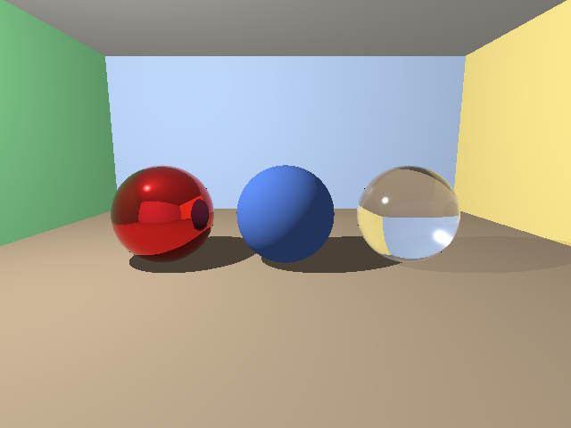

- 2球の基準シーン(`Room_2Spheres`)も中央に直した後

  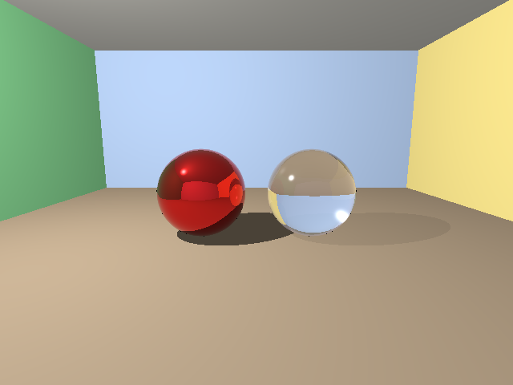

- 操作パネルの最初の版(Room_2Spheres、4spp・ジッタで再描画した後。画面なしのドライバで撮った画像)

  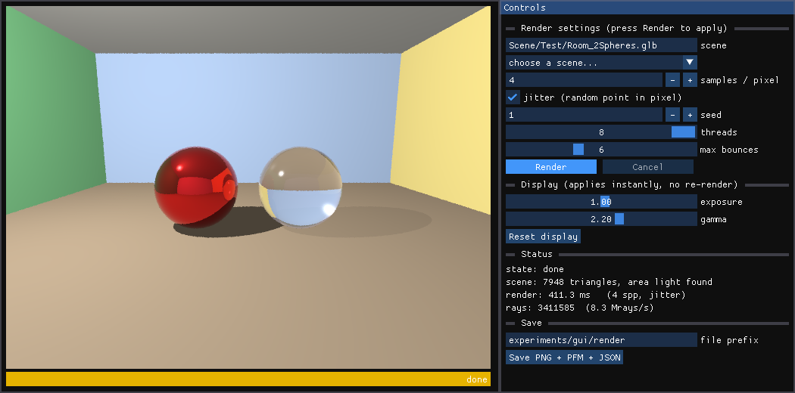

- 面光源のソフトシャドウ: 影の拡大(Room_2Spheres の金属球の影、同じ 64×48 ピクセルを6倍に拡大)。RMSE は面光源 1024spp の基準画像との差。

  | 点光源(M0) | 面光源 1spp | 面光源 4spp |
  |:---:|:---:|:---:|
  | 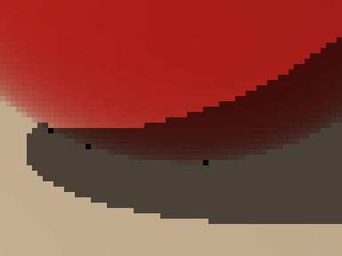 | 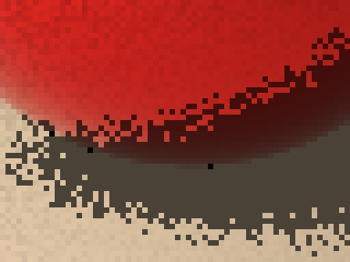 | 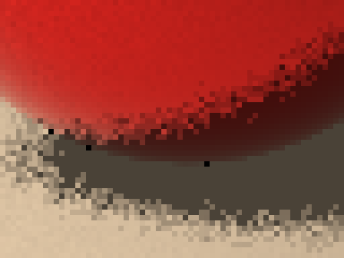 |
  | (照明が異なる) | RMSE 0.157 | RMSE 0.069 |

  | 面光源 16spp | 面光源 64spp | 基準 1024spp |
  |:---:|:---:|:---:|
  | 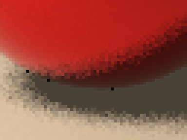 | 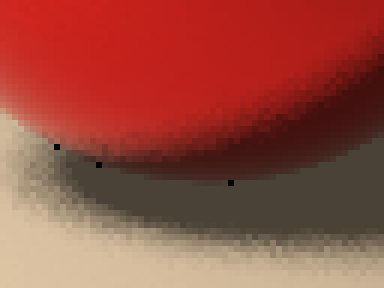 | 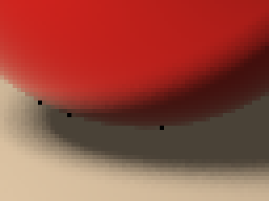 |
  | RMSE 0.035 | RMSE 0.018 | (基準) |

  点光源は縁がくっきりで、面光源は縁が半影になる。1spp ではざらつき、サンプルを増やすと滑らかになる。(全ての画像に、金属球の輪郭の下に、3つの小さな黒い点が見える。以前からの問題で、「黒い点の調査」に記録した。)

- 面光源(4spp・ジッタ)を設定した操作パネル(画面なしのドライバで撮った画像)

  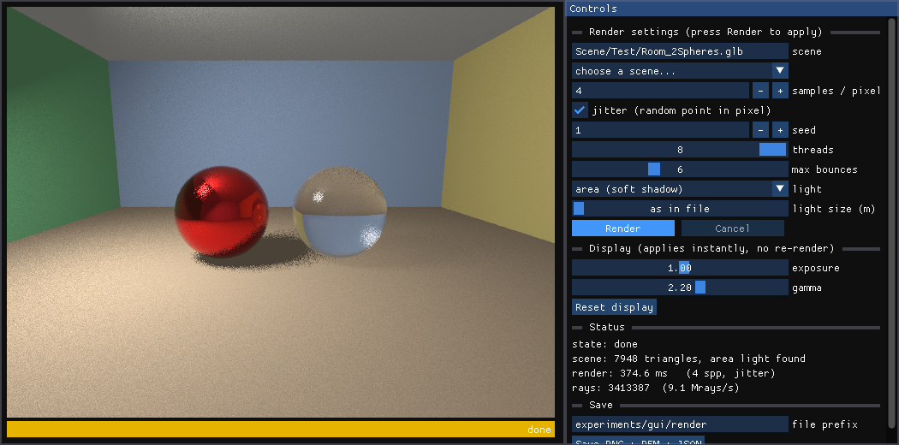

- 光源の大きさ × サンプル数(M1 の実験)。同じ 80×60 ピクセル(金属球の影)を3倍に拡大。行(上から): 光源の一辺 0.25 m(小)/ 2 m(中)/ 4 m(大)。列(左から): 1 / 4 / 16 / 64 spp / 基準(512 spp)。

  

  | 光源の大きさ | 半影の幅(床の上) | 1 spp の誤差 | 4 spp | 16 spp | 64 spp |
  |---|---|---|---|---|---|
  | 0.25 m | 0.043 m | 0.0489 | 0.0222 | 0.0108 | 0.0059 |
  | 2 m | 0.266 m | 0.1574 | 0.0690 | 0.0358 | 0.0184 |
  | 4 m | 0.513 m | 0.1679 | 0.0835 | 0.0434 | 0.0237 |

  (誤差は、各サイズの 512 spp の基準画像との RMSE。)

- **最新の状態**(M0・M1 完了時点)。標準の3球のシーン(`Untitled.glb`)、面光源、64 spp、ジッタあり、シード 1。左の球(金属)の影、中央の球(拡散)の影が、やわらかい半影になっている。

  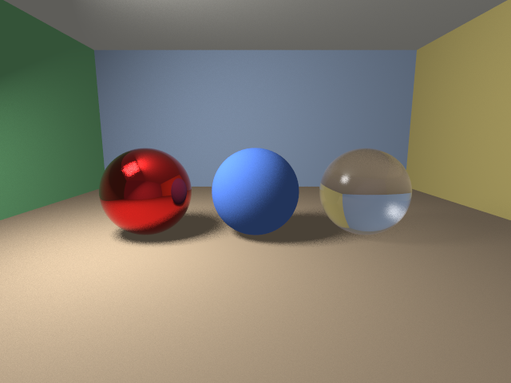

- 同じ設定の、操作パネルを含むウィンドウ全体(画面なしのドライバで撮った画像)。光源の種類(point / area)と大きさのコントロールが、パネルに加わっている。光源の項目を足したため、パネルが縦に収まらなくなったので、ウィンドウの高さを 520 → 600 に広げた。

  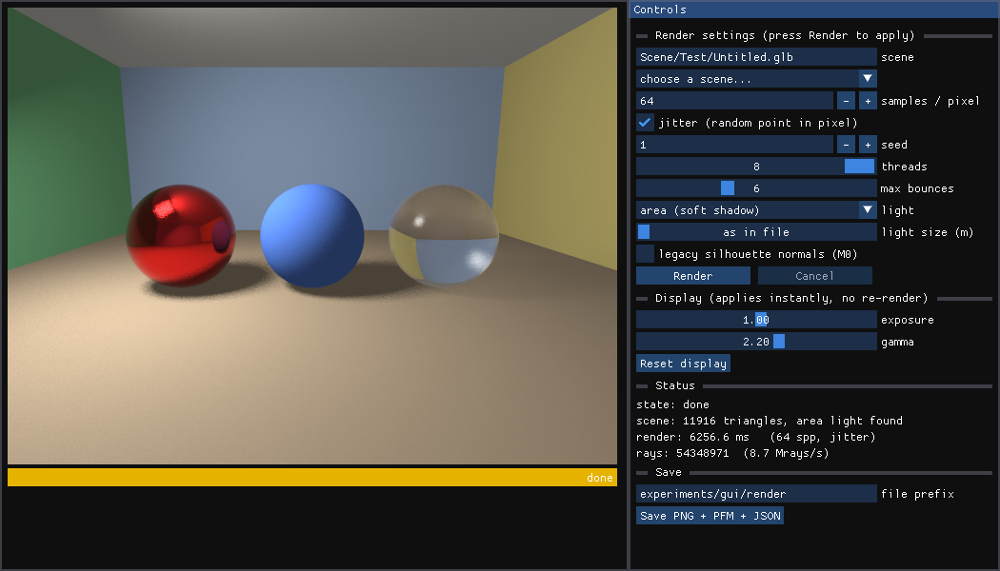

  (上の2枚は、黒い点の修正後に撮り直した。ウィンドウには「legacy silhouette normals (M0)」のチェックボックスが加わっている。)

- 黒い点の修正の前後(2球のシーン、1 spp、6倍に拡大)。左が修正前、右が修正後。上段: 金属球の左の輪郭、下段: ガラス球の右の輪郭。

  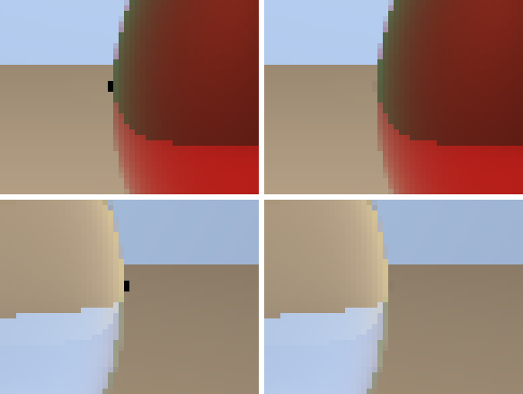

- サンプル数を変えた比較(M1 手順2、`Room_2Spheres`)。同じ 64×48 ピクセルの範囲(球の輪郭と床の縁)を、6倍に拡大。RMSE は 1024spp の基準画像との差(小さいほど基準に近い)。

  | ピクセル中心 1spp(M0) | ジッタ 1spp | ジッタ 4spp |
  |:---:|:---:|:---:|
  |  | 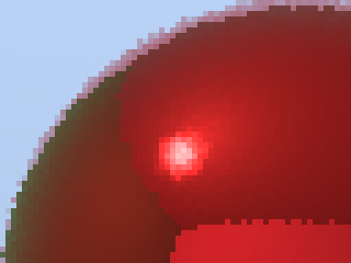 |  |
  | RMSE 0.0099 | RMSE 0.0199 | RMSE 0.0096 |

  | ジッタ 16spp | ジッタ 64spp | 基準 1024spp |
  |:---:|:---:|:---:|
  |  | 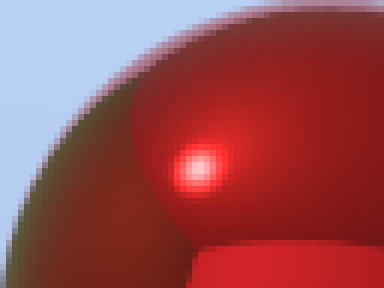 |  |
  | RMSE 0.0047 | RMSE 0.0024 | (基準) |

  1spp では輪郭がざらつき(ノイズ)、サンプルを増やすほど滑らかになって基準に近づく。実験の詳細は `experiments/2026-10-15_sampler-aa/notes.md`。

### 到達点
- **M0(現行実装の基準化)の完了条件を満たした**: 同じシーン・同じ設定で、比較可能な基準画像を再生成できる。現状の制約も文書化されている([CURRENT_IMPLEMENTATION.md](CURRENT_IMPLEMENTATION.md))。
- **M1(面光源とソフトシャドウ)の完了条件を満たした**: 矩形の面光源をランダムにサンプリングして、ソフトシャドウを描ける。光源の大きさに比例して半影が広がり、サンプルを増やすとノイズが 1/√N で減ることを、画像と数値で確認した。
- 操作パネル(Dear ImGui)で、サンプル数・ジッタ・シード・スレッド数・最大反射回数・光源(点 / 面)と大きさ・輪郭の扱い・露出・ガンマを変えて、再描画できる(**実機での操作は、まだ確認していない**)。テスト 212項目。
- M0 から含まれていた、金属球・ガラス球の輪郭の黒い点を修正した(旧方式は `--legacy-normals` で再現できる)。
- 計測値(Apple M1、8スレッド): 部屋 + 球2個で約90〜100 ms/フレーム(852,655レイ、1 spp)。1スレッドだと約418 ms。同じ条件でも時間は約10〜15%揺れる。
- 次は M2(最小のモンテカルロ・パストレーシング)に進める。

### 気づき・つまずき
- テストを書いたとき、自分で書いた三角形の頂点の順序(法線の向き)を間違えていた。プログラムのバグではなく、テストの誤りだった。法線の向きに依存しないことを、テストで両方の向きについて確認するようにした。
- 最初のテストでは、わざと入れたバグを BVH のテストしか検出できなかった。「斜辺のぎりぎり外」のケースを足して、直接のテストでも検出できるようにした。
- film 導入直後に、1回だけ約1.3秒という外れ値が出た(通常は約90 ms)。再現せず、原因は未特定。
- Blender のエリアライトは glTF に書き出されないため、点光源をコードに固定で置いている。M1 で面光源を扱うときに、メタデータの持たせ方を決める必要がある。
- 球は GLB の三角形メッシュとして扱うので、「レイと球」の交差判定は存在しない(ロードマップの記述とは異なる)。

### 次の一手
- **実機で操作パネルを触って、理解してから M2 に進む**(ユーザーの判断)。パネルの操作(Render / Cancel、サンプル数・ジッタ・光源の大きさ・露出)を実際に動かして、ここまでの内容の理解を確かめる。気づいたこと・不具合は、次のセッションの最初に反映する。
- (任意)輪郭の補正(cos = 0.01)の調整と、複雑なメッシュでの確認。
- [M2] 最小のモンテカルロ・パストレーシング(Lambert 拡散 BSDF、コサイン重み付き半球サンプリング、経路追跡)。拡散面どうしの間接光(カラーブリーディング)を、初めて扱う。ロードマップの Cornell Box を、Blender で作ることも検討。
- (任意)BVH なしとの比較や、シェーディングの数値テストを足す。

## 2026-10-14

### やったこと
- レイトレーサを新規に作成した(C++17 + SDL2)。
  - GLB(glTF 2.0)ローダ(JSON パーサも自前)。
  - 640x480 のフレームバッファに描画し、SDL2 のウィンドウに表示。完了後に `output.ppm` を保存。
  - 拡散反射(ランバート)、Blinn-Phong、硬い影、鏡面反射、ガラスの屈折(フレネル)。
- GitHub(`osa-traveler/Raytracer`、Private)にプッシュした。README を作成。コミットの作者は noreply アドレスにした。
- Blender で、1967年式フォルクスワーゲン・ビートル風のモデルを作成した(ボディ、フェンダー、キャビン、窓、ホイール、バンパー、ライト類など)。
- GLB のカメラの読み込みと、BVH による高速化を追加した(31万三角形のシーンが約5秒)。

### 到達点
- GLB のシーンを、カメラ込みで読み込んで描画できる。BVH とマルチスレッドで、高ポリゴンのモデルも描画できる。

### 気づき・つまずき
- 最初の GLB にはカメラが入っていなかった(エクスポート設定の問題)。書き出し直して解決した。
- Blender のエリアライトは glTF に対応しておらず、ライトは読み込めなかった。
- 面ごとの材質割り当てでは、窓の縁が階段状になった。ポリゴンを輪郭に沿って切り分ける方法で解決した。

### 次の一手
- ビートルはレンダリングが重いため、実験用のシーンからは外し、後の楽しみにとっておく。
