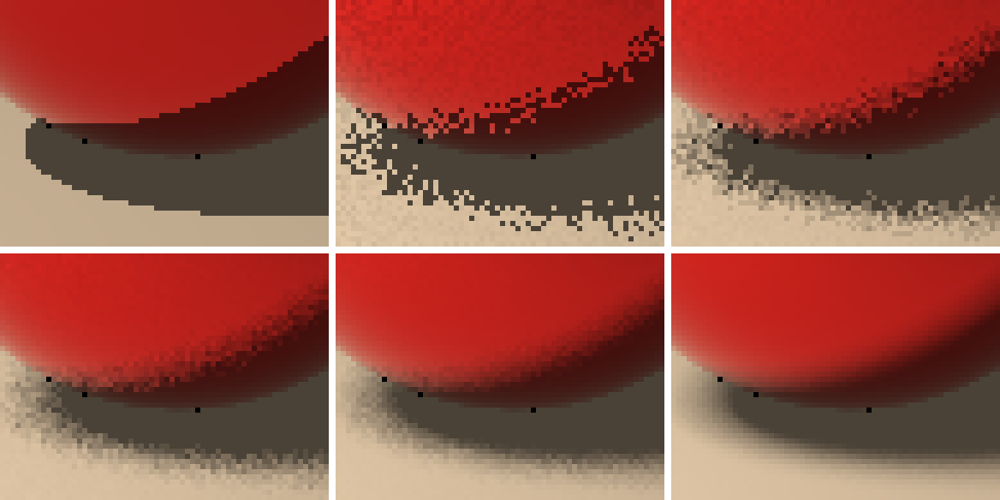

# 2026-10-15 area-light-spp (M1 手順3)

面光源(矩形)をランダムにサンプリングしたときの、影のやわらかさと、サンプル数に対する誤差の減り方。

## 再生成

```sh
sh experiments/2026-10-15_area-light-spp/run.sh                 # 約3分
python3 -I experiments/2026-10-15_area-light-spp/make_montage.py # shadows.png と docs/screenshots の拡大画像
```

## 設定

- シーン: `Scene/Test/Room_2Spheres.glb`(640x480、最大反射回数6、ジッタなし = ピクセル中心)。
- 面光源: 2 m × 2 m、`rt_radiance` = 11.56、中心 (-4, 5, 2)、部屋の中心に向けて斜め下に発光。サンプリングは、ヒットごとに光源上の一様ランダムな点を1つ。
- 乱数: PCG32、シード 1(基準画像は 777)。基準(reference): 面光源 1024 spp。
- 比較: 点光源(M0 の基準方式)。`*.pfm` は Git 対象外(`run.sh` で再生成)。

## 結果



`shadows.png`: 同じ 64×48 ピクセルの範囲(金属球の影)を6倍に拡大。左上から右へ、下段へ:
点光源 / 面光源 1spp / 4spp / 16spp / 64spp / 基準(1024spp)。

| 画像 | RMSE(面光源の基準との差) | 前の行との比 | 描画時間(1回測定) | レイ数 |
|---|---|---|---|---|
| 点光源(M0 方式) | 0.2654 | | 92 ms | 852,655 |
| 面光源 1spp | 0.1573 | | 109 ms | 853,055 |
| 面光源 4spp | 0.0689 | 2.28 | 357 ms | 3,412,138 |
| 面光源 16spp | 0.0353 | 1.95 | 1,343 ms | 13,648,300 |
| 面光源 64spp | 0.0175 | 2.02 | 5,394 ms | 54,594,884 |
| 面光源 256spp | 0.0096 | 1.82 | 21,391 ms | 218,380,227 |
| 面光源 1024spp(基準) | (基準) | | 86,102 ms | 873,528,391 |

## 観察

- **影の縁が半影になる**: 点光源は縁がくっきり(階段状のジャギー)、面光源は、影の濃い部分(本影)のまわりに、だんだん薄くなる部分(半影)ができる。
- **サンプルが少ないと、半影がざらつく**: 1spp では、光源のどの点を選んだかによって、「影か、日向か」がピクセルごとにばらける。サンプルを増やすと、滑らかな勾配になる。
- **誤差は 1/√N で減る**: サンプルを4倍にすると、誤差はほぼ1/2(2.28、1.95、2.02、1.82 倍)。最後の段は、基準画像のノイズの影響(ジッタの実験と同じ理由)。
- 面光源の 1spp のRMSEは、点光源より小さく見えるが、基準が面光源なので、**照明の違い(距離減衰、影のぼけ)を測っている**。点光源とは、別の画像として扱う。
- 影のレイは1本のままなので、レイ数は変わらない。時間は 1spp で約15%増(光源の点の選択と、重みの計算)。

## 気づいたこと

- 3つの小さな黒い点が、すべてのタイル(点光源と基準を含む)の同じ位置にある。調べると、金属球の輪郭の下部で、接線に近い角度のレイが球の表面で反射して球自身に当たり続け、最大反射回数で打ち切られて色が 0 になっていた(三角形メッシュの球の、補間した法線と実際の面の向きのずれ)。M0 の基準画像にも含まれる既知の問題で、今回の変更とは無関係。画像全体で14ピクセル(2球のシーン)。
- 光源の大きさを変える実験(1/4/16/64 サンプル × 小さい光源・大きい光源)は、次の手順で行う。

## 限界

- 時間は1回の測定で、約±15% の揺れがある。
- 誤差は画像全体の RMSE で、影の領域以外(滑らかな領域)も含む。
