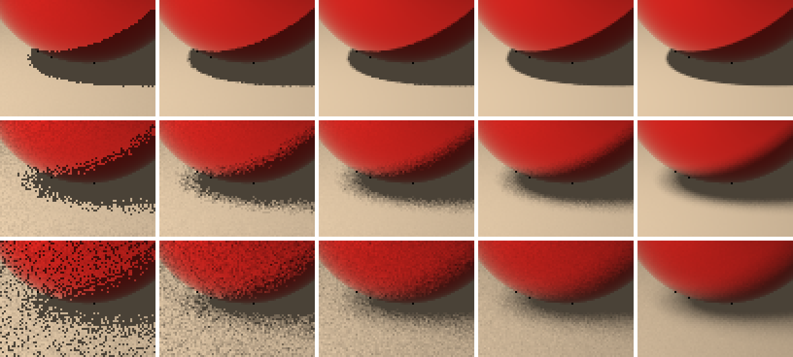

# 2026-10-15 light-size-spp (M1 の実験)

面光源の大きさ(小・中・大)× 1ピクセルあたりのサンプル数。ロードマップ M1 の実験
「小さい面光源と大きい面光源で、球の影を 1/4/16/64 サンプル比較」。

## 再生成

```sh
sh experiments/2026-10-15_light-size-spp/run.sh                    # 約4分
python3 -I experiments/2026-10-15_light-size-spp/analyze.py         # 半影の幅、size_x_spp.png
```

## 設定

- シーン: `Scene/Test/Room_2Spheres.glb`(640x480、最大反射回数6、ジッタなし)。
- 面光源: 正方形、中心 (-4, 5, 2)、部屋の中心に向けて斜め下に発光。**一辺 0.25 m / 2 m(GLB のとおり)/ 4 m**。大きさを変えても総電力(放射輝度 × 面積)は一定。
- サンプル数: 1 / 4 / 16 / 64 spp(シード 1)。基準(reference): 各サイズ 512 spp(シード 777)。
- `*.pfm` と、`size_x_spp.png` 以外の PNG は Git 対象外(`run.sh` で再生成)。

## 結果



`size_x_spp.png`: 同じ 80×60 ピクセルの範囲(金属球の影)を3倍に拡大。
行(上から): 光源 0.25 m(小)/ 2 m(中)/ 4 m(大)。列(左から): 1 / 4 / 16 / 64 spp / 基準(512 spp)。

### 半影の幅は、光源の大きさに比例して広がる

床の上の影の縁(列 x = 250)で、「影の明るさ」から「日向の明るさ」への変化の 10%〜90% の幅(各サイズの 512 spp の基準画像から)。

| 光源の大きさ | 幅(ピクセル) | 幅(床の上、m) | 幅 ÷ 光源の大きさ |
|---|---|---|---|
| 0.25 m | 0.85 | 0.043 | 0.171 |
| 2 m | 5.31 | 0.266 | 0.133 |
| 4 m | 10.26 | 0.513 | 0.128 |

- 2 m と 4 m では、幅 ÷ 大きさがほぼ一定(0.133、0.128)。**半影の幅は光源の大きさに比例**する(幾何学的には、`幅 = 光源の大きさ × (影を作る物体から床までの距離) ÷ (光源から物体までの距離)`)。
- 0.25 m は、幅が 1 ピクセル未満(床の上で 5 cm 弱)で、ピクセルの大きさに近く、測定の分解能の限界。比がやや大きいのは、そのため。

### 誤差(各サイズの 512 spp の基準との RMSE)

| 光源の大きさ | 1 spp | 4 spp | 16 spp | 64 spp |
|---|---|---|---|---|
| 0.25 m | 0.0489 | 0.0222 | 0.0108 | 0.0059 |
| 2 m | 0.1574 | 0.0690 | 0.0358 | 0.0184 |
| 4 m | 0.1679 | 0.0835 | 0.0434 | 0.0237 |

サンプル4倍ごとの誤差の比(1→4、4→16、16→64): 0.25 m は 2.20 / 2.06 / 1.83、2 m は 2.28 / 1.93 / 1.95、4 m は 2.01 / 1.93 / 1.83。

## 観察

- **光源が大きいほど、半影が広がる**(上から下へ)。小さい光源は、影の縁がほぼくっきり。
- **光源が大きいほど、同じサンプル数でのノイズが多い**: 1 spp の誤差は、0.049 → 0.157 → 0.168。半影の領域が広がり、「光源のどの点を選ぶか」で、影か日向かがばらつくピクセルが増えるため。大きさが大きくなると、増え方は頭打ちになる(2 m → 4 m)。
- **どの大きさでも、サンプル4倍で誤差はほぼ 1/2**(1/√N)。最後の段(64 spp)の比が少し小さいのは、基準画像(512 spp)自体のノイズの影響。
- **小さい光源は、少ないサンプルで足りる**: 0.25 m の 1 spp(0.049)は、2 m の 16 spp(0.036)に近い。逆に、大きい光源は、同じ画質のために多くのサンプルが必要。
- 総電力を一定にしているので、光源が大きくなっても、日向の明るさは、ほぼ同じ(影のやわらかさだけが変わる)。ただし、4 m では日向がやや暗い(0.41、他は 0.52〜0.54): 光源の端が、床の点に対して、より斜めになり、cos の項と距離が変わるため。

## 限界

- 半影の幅の測定は、1つの位置(列 x = 250)のみ。
- 画像全体の RMSE は、影以外の領域も含む。
- 基準画像は 512 spp なので、64 spp の誤差には、基準のノイズ(約 1/√512 倍)が含まれる。
- 金属球・ガラス球の輪郭に、数ピクセルの黒い点がある(のちに修正した。`experiments/2026-10-15_silhouette-fix/`。この実験の画像は旧方式 = `--legacy-normals` で作ってあり、`run.sh` にもそのスイッチがある)。ジッタなしの画像(この実験)では、多サンプルにしても、同じピクセルのサンプルが同じ位置を通るので、薄まらずに残る。
