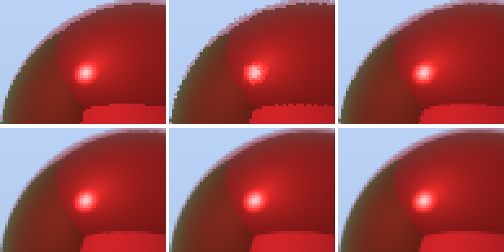

# 2026-10-15 sampler-aa (M1 手順2)

乱数とサンプラの最初の利用: ピクセル内のランダムな位置にサンプルを置く(ジッタ = アンチエイリアス)。
サンプル数に対して、誤差がどう減るかを測る。

## 再生成

```sh
sh experiments/2026-10-15_sampler-aa/run.sh          # 約2分
python3 -I experiments/2026-10-15_sampler-aa/make_montage.py   # edges.png
```

## 設定

- シーン: `Scene/Test/Room_2Spheres.glb`(640x480、最大反射回数6、点光源、露出 1.0・ガンマ 2.2)。
- 乱数: PCG32、ピクセルごと・サンプルごとに独立した列。全体のシード 1(基準画像は 777)。
- 基準(reference): ジッタ 1024 spp。他の画像との差(RMSE、線形値)を測る。
- `*.pfm` と、`edges.png` 以外の PNG は Git 対象外(`run.sh` で再生成)。

## 結果



`edges.png`: 同じ 64×48 ピクセルの範囲(球の輪郭と床の縁)を6倍に拡大。左上から右へ、下段へ:
ピクセル中心 1spp / ジッタ 1spp / ジッタ 4spp / ジッタ 16spp / ジッタ 64spp / 基準(1024spp)。

| 画像 | RMSE(基準との差) | 前の行との比 | 描画時間(1回測定) | レイ数 |
|---|---|---|---|---|
| ピクセル中心 1spp(M0 の基準) | 0.00993 | | 87 ms | 852,655 |
| ジッタ 1spp | 0.01993 | | 89 ms | 853,106 |
| ジッタ 4spp | 0.00959 | 2.08 | 337 ms | 3,411,585 |
| ジッタ 16spp | 0.00467 | 2.06 | 1,300 ms | 13,647,610 |
| ジッタ 64spp | 0.00240 | 1.94 | 5,186 ms | 54,593,792 |
| ジッタ 256spp | 0.00148 | 1.62 | 20,485 ms | 218,374,316 |
| 基準 1024spp | (基準) | | 82,159 ms | 873,489,525 |

## 観察

- **誤差は 1/√N で減る**: サンプル数を4倍にすると、誤差は約1/2(2.08、2.06、1.94倍)。理論どおり。
  最後の 1.62倍 は、基準画像自身に残るノイズ(約 0.0199/√1024 = 0.0006)を含むため。256spp の誤差は、ノイズがなければ約 0.00125 のはずで、基準のノイズを足した √(0.00125² + 0.0006²) ≈ 0.0014 と測定値 0.00148 は整合する。
- **ジッタ 1spp は、ピクセル中心の 1spp より誤差が2倍大きい**: ジッタは、輪郭のバイアス(ジャギー)をなくす代わりに、ノイズを足す。4spp でほぼ同等になり、16spp から明確に良くなる。
- 時間はサンプル数にほぼ比例する(87 ms → 約 20 秒、256倍)。誤差を半分にするには、4倍の時間がかかる。
- サンプル番号 k の乱数列は、サンプル数によらず同じ(`(シード, ピクセル, k)` で決まる)。4spp の画像は、1spp の画像のサンプルを含む。後で「サンプルを追加していく」(M3)ための性質。

## 限界・注意

- 時間は1回の測定で、約±15% の揺れがある。
- 誤差は画像全体の RMSE。ほとんどのピクセルは滑らかな領域なので、輪郭(約1,000ピクセル)の誤差が全体の値を支配している。
- ジッタの分布は一様(ボックスフィルタ)。ピクセルより広い再構成フィルタ(ガウスなど)は未実装。
